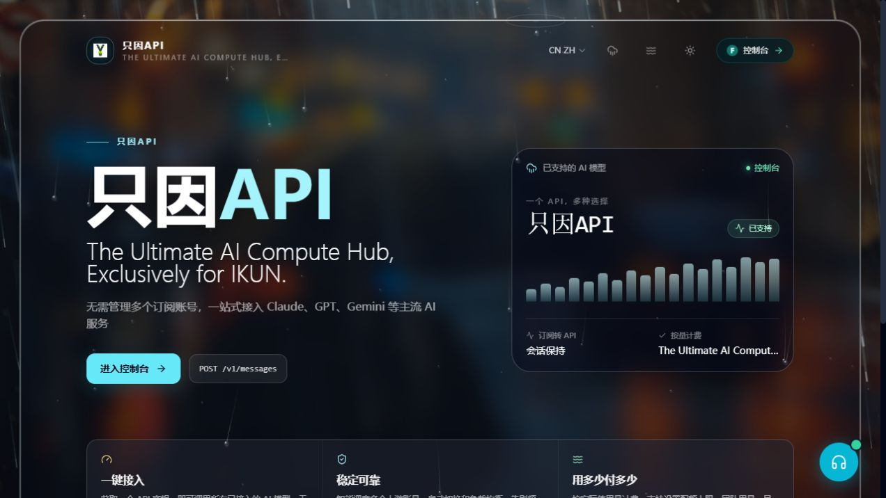
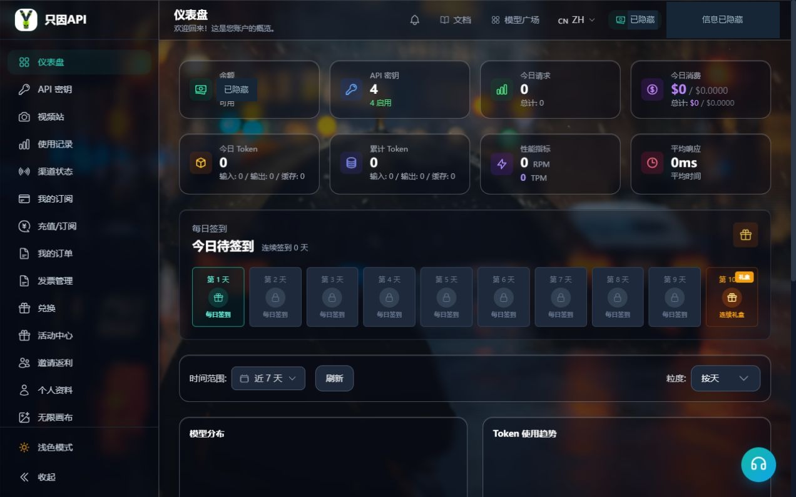
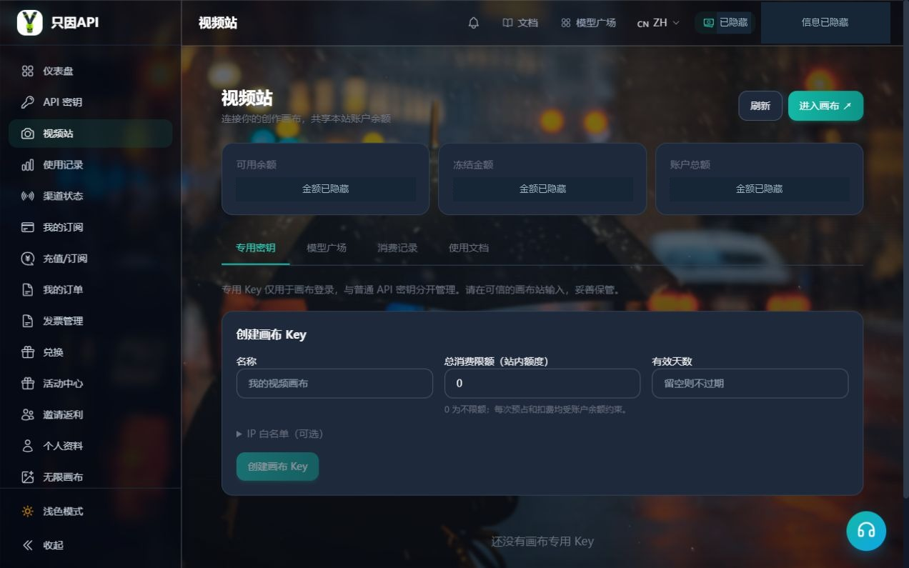
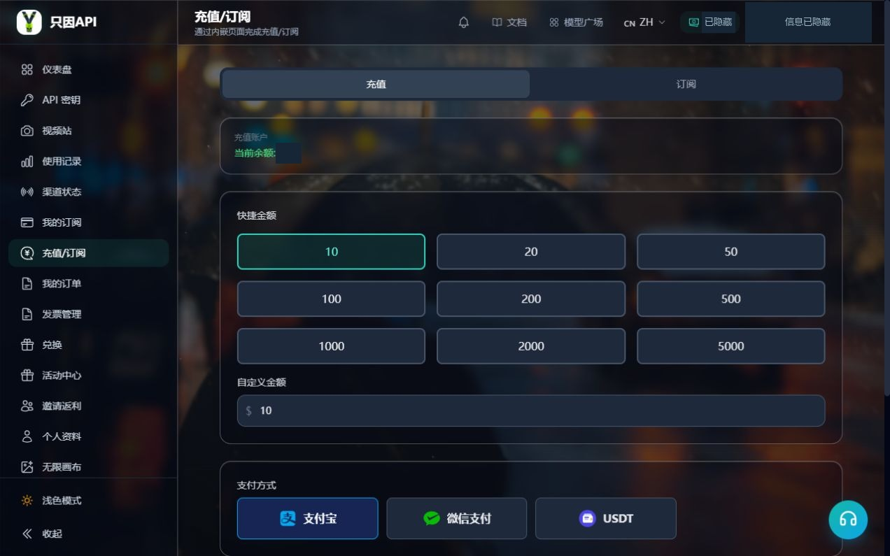
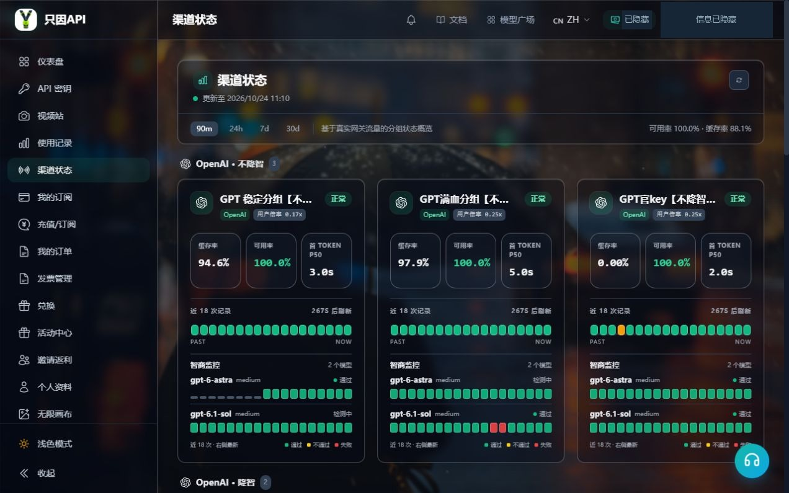

# 认识只因 API：网站功能导览

第一课 · 新手起步 · 更新于 2026-10-24

学完这一课，你能找到选模型、管理密钥、查看消费和进入创作的位置。先打开网站跟着认一遍入口，这一课不用创建密钥、充值或提交生成任务。

## 1. 先分清：网站、工具和模型

**只因 API 网站**负责管理你的本站账户、余额或订阅、密钥和使用记录。**客户端或创作页面**是你输入要求、查看结果的地方，例如聊天软件、Codex、Claude Code 或创作画布。**模型**负责理解要求和生成内容，例如 GPT、Claude、DeepSeek 系列中的具体模型。

可以把一次使用记成这条路线：

> 在本站准备账户和凭据 → 在支持的工具中配置服务 → 选择可用模型 → 提交任务 → 查看结果和消费。

不同工具的接入方法可能不同。本站账户、工具官方账户和官方会员也各有用途，不能相互替代。后续教程会按你选择的工具给出具体步骤。

## 2. 首页：找到进入网站的方向

入口：[只因 API 首页](https://www.yydsapi.uno/home)。

首页适合第一次访问时了解服务、找到登录或控制台入口，也可以进入公开的模型信息页面。

**这次只需找一找：** 从哪里登录或返回控制台，以及模型广场在哪里。以后已经登录时，可以直接进入控制台，不必每次重新走首页。

## 3. 仪表盘：查看账户与使用概况

入口：登录后进入「仪表盘」。

仪表盘是账户的总览页。你可以快速了解账户概况和近期使用情况，再从左侧导航进入具体功能。页面上显示的统计会随账户和日期范围变化。

**什么时候看：** 刚登录、使用前检查账户情况、使用后想了解总体消耗时。

**这次只需找一找：** 左侧导航、账户概况区域和用量统计。截图里的数字属于拍摄时的账户，不是新用户默认额度。

## 4. 模型广场：了解能选什么

入口：[模型广场](https://www.yydsapi.uno/model-plaza)。

模型广场用来查询平台、分组、模型和价格说明。可以先搜索熟悉的名称，再查看具体模型支持的用途。聊天、识图、生成图片是不同能力，不能只凭名字判断。

**什么时候看：** 准备选择模型，或想确认某个模型名称、计价方式时。

**这次只需看三项：** 模型名称、所属分组、价格单位与说明。分组会影响可用模型和使用规则；具体能否使用，还要结合账户权限和对应密钥。价格与单位以当页为准。

## 5. API 密钥：连接支持的客户端

入口：左侧「API 密钥」。

API 密钥是客户端向本站证明使用身份的凭据。后续连接聊天软件或编程 Agent 时，会按对应教程使用它。这里可以管理密钥、查看状态及所属分组，具体配置选项以页面为准。

**什么时候看：** 第一次配置客户端，或检查密钥是否停用、过期、达到限额时。

**这次只需知道：** 密钥和账户余额是两回事，密钥限额也不是充值到账的余额。完整密钥需要保密；本课只认识页面，创建与填写方法留到对应客户端教程。

## 6. 视频站：进入创作画布

入口：侧栏「视频站」入口。

视频站连接本站与创作画布。这里提供进入画布的入口，并管理画布专用密钥、查看相关模型和账务；实际创作与作品查看在画布中完成。

**什么时候看：** 准备通过画布生成图片或视频，或核对画布任务的账务时。

**这次只需找到：** 进入画布的按钮，以及密钥、模型和账务相关标签。画布专用密钥与普通 API 密钥用途不同，后续按视频或图片教程准备。入口可见也不代表每个模型、参数都对当前账户开放。

## 7. 使用记录：找到一次调用的消费

入口：左侧「使用记录」。

使用记录帮助你核对本站记录到的调用情况。可以按页面提供的条件查找记录，查看模型、时间、用量、费用和耗时等信息。

**什么时候看：** 完成一次对话或任务后，想知道是否产生调用、花费多少，或排查异常时。

**这次只需找到：** 时间筛选与记录列表。没有记录时，先确认日期和筛选条件。画布任务还应到视频站对应账务中核对，不能把不同入口的记录混在一起理解。

## 8. 充值与订阅：准备所需额度

入口：左侧「充值/订阅」；部分情况下菜单显示为「充值」。

使用前需要了解所选路线需要哪些额度或权益。充值和订阅的规则不同：充值关注支付与到账，订阅还要查看适用分组、有效期和额度规则。

**什么时候看：** 已确定要使用的模型与路线，需要准备对应额度时。

**这次只需看：** 当前提供哪些方式、页面如何说明到账或套餐权益。先选路线，再按后续教程准备额度，不用为完成本课下单。付款结果到「我的订单」核对，已购订阅到「我的订阅」查看。

## 9. 渠道状态：遇到异常时辅助判断

入口：左侧「渠道状态」。

这里帮助你了解页面展示的服务状态和检测情况。遇到调用失败或变慢时，可以结合报错、密钥与额度情况一起检查。

**这次只需看：** 状态对应哪个渠道或模型、检测时间是什么时候。某次检测正常不保证每一次请求都成功；也不要只凭一个状态就认定问题一定来自服务端。

## 10. 其他入口：需要时再来

| 功能 | 什么时候使用 |
| --- | --- |
| 我的订单 | 查看充值或购买记录，核对订单状态 |
| 我的订阅 | 查看已购订阅、有效期和剩余额度 |
| 个人资料 | 管理个人信息、密码及已开放的安全设置 |
| 兑换 | 手里有兑换码时，查看可兑换的权益与结果 |
| 活动、邀请返利 | 阅读当前活动资格、奖励条件和领取规则 |

菜单会随账户权限和网站开放情况变化。你的界面与截图不同，先查看当前菜单和公告，不必照着截图寻找每一项。部分次要入口也可能在简洁导航中隐藏。

## 做一个找入口练习

不进行付费操作，回答下面三个问题：

1. 想看看有哪些模型、怎样计价，去哪里？——**模型广场**。
2. 要给支持的客户端配置本站凭据，去哪里？——**API 密钥**。
3. 想核对一次调用的费用，去哪里？——**使用记录**；画布任务另看视频站账务。

能找到这三个入口，就完成了第一课。接下来选择你的目的：第一次对话、第一张图片、第一段视频，或第一个 Agent 任务；我们会在对应路线中一步一步完成准备和使用。

---

编写记录（不放入学员页面）：截图采集与页面入口需由主编按实际登录界面复核；本文没有宣称已完成付费调用或生成。当前模型广场有 1:10 说明，旧研究保留 1:1 单位迁移记录，两者待按线上真实计价及充值口径核对，本课未引用任何固定换算比例。图片相对路径从本稿所在 content 目录指向 preview；网页渲染时使用 assets/site-introduction/ 下同名文件。
