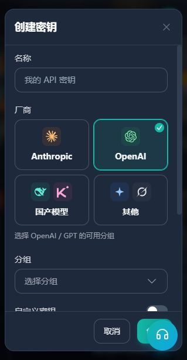

# 开始使用 GPT：用 Codex 完成第一个任务

所属分类：对话与写作 → GPT。分类页同时提供 Claude、DeepSeek 的 Claude Code 教程；GPT 不再占用独立侧栏。原 #gpt 及路线深链接保留。

第二课 · Windows 新手教程 · 更新于 2026-10-24

上一课，我们认识了网站、密钥和使用记录。这一课，我们把本站接入 Codex，发送第一条消息，再追问一次。你可以选择命令行或桌面客户端，完成其中一条路线即可。

学完后，你能收到一份三步练习计划、继续追问一次，并回到本站找到对应的使用记录。本课演示的是通过本站服务使用 GPT 的本地会话；具体可用模型和费用以你的密钥分组、账户权益与当前页面为准。

### 两种使用方式

GPT 是理解要求、生成回答的模型，Codex 是这次输入问题和查看结果的工具。Codex 还能够操作文件和运行命令，我们先用简单对话检查接入是否成功。

| 使用方式 | 你会怎样操作 |
| --- | --- |
| Codex CLI 命令行 | 在 PowerShell 里启动 Codex，再在它的输入区提问 |
| Codex 桌面客户端 | 安装官方桌面应用，进入 Codex，用输入框提问 |

两种方式都需要下面的本站密钥与配置。先完成共同准备，再阅读自己选择的路线；不必为了本课同时安装两个工具。

## 1. 准备本站密钥和模型

登录 [只因 API](https://www.yydsapi.uno)，打开左侧「API 密钥」。



1. 点击创建密钥，为它取一个容易识别的名称，例如“GPT 入门练习”。
2. 在厂商中选择 **OpenAI**。表单最初可能选中 Anthropic，需要主动切换。
3. 选择你要使用的 **OpenAI/GPT 可用分组**，并确认自己有该分组需要的额度或订阅权益。
4. 检查密钥的额度限制、有效期等选项，再完成创建。页面中的额度限制不等于充值余额；`0` 的含义以旁边提示为准，当前表单表示不另设该项额度上限。
5. 回到密钥列表，打开这枚密钥的使用说明，找到对应的 Codex 配置。

如果已有合适的密钥，可以直接使用。本课需要的是这里的普通 API 密钥；视频站中的画布专用密钥用于另一条路线。

完整密钥只填写在你自己电脑的配置中。截图、求助和分享配置时，都应遮住或删除它。

**这一步完成的标志：**你知道要用哪枚密钥、哪个分组，以及该分组允许使用的完整模型名称。

## 2. 选一种使用方式并安装

两条路线使用相同的配置和练习。任选其一，桌面路线不需要先安装 Node.js 或 Codex CLI。

### 路线 A：Codex CLI 命令行

#### 安装 Node.js

打开 [Node.js 官方下载页](https://nodejs.org/zh-cn/download)，选择适合自己 Windows 的 **LTS** 版本，按安装程序完成安装。

如果电脑已经有可用的 Node.js 和 npm，可以跳过安装。打开开始菜单，搜索 PowerShell 并打开，分别输入下面的命令检查：

```powershell
node --version
```

```powershell
npm.cmd --version
```

看到版本号即可。这里使用 `npm.cmd`，让 Windows 直接运行 npm 的命令文件。每次只复制一块命令，不要复制示例窗口前面的 `PS C:\...>` 提示符。

#### 安装 Codex CLI

在 PowerShell 中输入：

```powershell
npm.cmd install -g @openai/codex
```

等待安装结束，关闭旧的 PowerShell 窗口，重新打开一个，再输入：

```powershell
codex.cmd --version
```

出现版本号，说明 Codex 程序可以启动。这个检查还没有验证模型调用。Windows 中使用 `npm.cmd`、`codex.cmd`，可以避免误运行被 PowerShell 策略拦截的同名 `.ps1` 包装脚本。

### 路线 B：Codex 桌面客户端

打开 [桌面版官方入口](https://learn.chatgpt.com/docs/app)，选择 Windows 下载入口，按安装器或商店提示完成安装。桌面路线不需要先安装 Node.js 或 Codex CLI。

当前官方文档把桌面应用称为 **ChatGPT desktop app**，其中有 Codex 入口；部分版本仍使用 Codex 名称。以官方页面实际提供的安装包为准。

启动应用，认识它的窗口。若出现登录页，先继续下一节保存本站配置和密钥，再完全退出并重新打开应用。本课使用本站 API 密钥对应的本地模式。

**做到这里，应该看到：**应用能够打开。安装完成不等于已经接入本站。

## 3. 把 Codex 连接到本站

本课将模型、服务地址和本站密钥写入一个 `config.toml`。命令行与 Windows 桌面端使用相同的配置目录，首次配置一次即可。

### 打开配置文件夹

1. 先关闭 Codex。按 Win + R，输入 `%USERPROFILE%\.codex` 并回车。
2. 如果找不到这个文件夹，先打开 `%USERPROFILE%`，再新建名为 `.codex` 的文件夹。
3. 如果已有 `config.toml`，先复制到自己保管的备份文件夹，再合并本课设置。配置和备份都可能含有密钥，请妥善保管。
4. 在资源管理器中开启“查看 → 显示 → 文件扩展名”。记事本保存时选择“所有文件”、UTF-8 编码，避免文件名多出 `.txt`。

### 保存 config.toml

下面是根据站方提供的现用配置提取的通用示例。将 `experimental_bearer_token` 引号内的占位文字替换为你自己的完整本站 API Key，模型则按当前分组允许的 ID 填写。

```toml
model_provider = "custom"
model = "gpt-6-astra"
model_reasoning_effort = "xhigh"
disable_response_storage = true

[model_providers.custom]
name = "只因 API"
base_url = "https://www.yydsapi.uno"
wire_api = "responses"
requires_openai_auth = true
experimental_bearer_token = "在这里替换为你的本站API密钥"
```

- `model_provider` 必须与 `[model_providers.custom]` 表头中的名称对应；`name` 只是显示名称。
- `gpt-6-astra` 和 `xhigh` 是本课示例。模型需要你的分组支持；其他模型请按其支持的推理档位调整。网页里的模型 ID 输入框会同步更新配置示例。
- 本版 `base_url` 使用 `https://www.yydsapi.uno`，协议为 `responses`。其他版本的接入模板可能要求不同路径，按对应说明核对。
- 本课沿用直接令牌方式，密钥保存在 `config.toml` 中。只在自己电脑上替换，不要粘贴到教程网页或聊天中。
- `disable_response_storage = true` 沿用所提供配置的响应存储选项，支持情况取决于客户端；它不代表服务端一定不保存数据。

已有配置时，更新顶层的 `model_provider`、`model`、`model_reasoning_effort` 和 `disable_response_storage`。顶层键必须在第一个方括号表头之前，同名键与 `[model_providers.custom]` 只能出现一次。插件、项目和本机运行设置可以保留。如果使用 profile、自定义 CODEX_HOME 或公司统一配置，先核对实际生效位置。

### 可选：model_catalog_json

这个选项用于加载本地 JSON 模型目录。只有已经获取目录文件时才添加，将下面一行放到第一个方括号表头之前，并替换为实际完整路径：

```toml
model_catalog_json = 'C:\完整路径\codex-models.json'
```

TOML 单引号可以保留 Windows 路径中的反斜杠。不要照抄别人的用户名或不存在的路径。模型目录里出现名称，也不代表你的密钥有调用权限。

### 检查后重新打开 Codex

确认文件名是 `config.toml`，模型与地址正确，密钥占位文字已替换。如果填写了模型目录路径，对应文件必须真实存在。完全退出 Codex，再重新打开并新建聊天。

本课密钥已写在 `config.toml` 中，无需按旧版步骤另建 `auth.json`。已有登录或认证配置时，先核对当前供应商。本站“使用密钥”中的其他模板应成套使用，不要把多种认证方式直接叠加。

**完成标志：**配置目录中已有保存好的 `config.toml`，没有 `.txt` 后缀；模型、本站地址和密钥对应正确。保存文件本身不等于调用已成功。

## 4. 打开练习目录

在资源管理器的“文档”中新建一个空文件夹，命名为 `codex-practice`。它就是本课的工作目录，后面生成的练习文件放在这里。

### 命令行路线

进入 `codex-practice`，点击资源管理器地址栏，输入 `powershell` 并回车。新窗口会从这个文件夹打开。先检查当前目录：

```powershell
Get-Location
```

确认显示的是刚创建的练习文件夹，再启动 Codex：

```powershell
codex.cmd
```

如果出现文件夹信任或 Windows 沙箱设置，确认路径是练习文件夹，再按客户端提示完成。启动后输入 `/status`，核对当前模型、供应商和工作目录；`/permissions` 可以查看权限。本课保留默认保护设置即可。

**做到这里，应该看到：**Codex 的任务输入区域，工作目录是 `codex-practice`，模型与配置一致。若仍要求登录或报错，先看第 7 节排查表。后面的问题应发到 Codex 输入区，不是 PowerShell 命令。

### 桌面客户端路线

1. 保存配置后完全退出应用，再从开始菜单打开。如果有托盘图标，也检查它是否仍在运行，确保旧进程已退出。
2. 在产品切换入口选择 **Codex**。打开文件夹或新建项目，选择刚才的 `codex-practice`，并选择本地工作方式。
3. 在这个项目中点击“新聊天 / New chat”。检查输入框附近的模型和当前项目；更换模型时只选本站分组支持的名称。看到权限提示时，确认操作范围是练习文件夹。

如果仍显示登录页，先核对 `config.toml` 的位置和密钥。官方桌面端的 API Key 入口通常为“Sign in another way（其他登录方式）”；只有确认当前已选用本站供应商配置时，才使用本站 Key。直接走 ChatGPT 登录并不能证明已经接入本站。

**做到这里，应该看到：**Codex 本地聊天输入框，已经选中练习文件夹与目标模型。

## 5. 发送第一条任务，再追问一次

无论选择哪条路线，都可以复制这段话到 Codex 的输入区：

```text
请用中文帮我安排一个 30 分钟的 AI 入门练习。
要求：分成 3 个步骤，每步写明用时和完成标准。
只在对话里回答，暂时不要读取文件、修改文件或运行命令。
```

这段话告诉模型想完成什么、希望怎样呈现，以及本次任务的范围。

等待回复结束。你要找的是三个步骤、每步用时和每步完成标准。文字不必与别人完全一样，重点是模型理解了要求。在同一条聊天里继续发送：

```text
把刚才的计划改成 15 分钟，保留最重要的一步，并解释为什么保留它。
```

这次应该得到缩短后的计划，并解释保留哪一步。能结合上一条内容修改，就完成了“提问 → 追问”的练习。模型自称某个版本不能证明实际使用的型号，应结合工具设置与本站使用记录核对。

### 可选练习：让 Agent 创建一个文件

完成对话后，如果想看看 Codex 操作文件的方式，可以在自己的练习文件夹中发送：

```text
请把刚才的 15 分钟计划保存为当前练习文件夹中的 ai-plan.md。
如果这个文件已经存在，请先问我，不要覆盖。只创建这个文件，不改其他文件。
```

查看它展示的操作与结果。若出现权限确认，先看清它要在哪个文件夹做什么，再决定是否继续。完成后打开 `ai-plan.md`，确认内容确实写进文件。

这一步会产生新的模型调用，可以留到以后再做；完成第一次对话不要求执行它。

## 6. 检查结果，也检查消费

打开本站左侧「使用记录」，把日期范围设为今天，必要时按刚才的密钥筛选。


核对三件事：三步计划完整且追问后时长有调整；当前模型与供应商指向本站；使用记录中的密钥、模型、时间和费用能够对应。上图用于认识页面位置，实际记录以你自己这次使用后的页面为准。

一次 Codex 交互可能包含多次请求，所以记录行数不一定与聊天消息数一一对应。费用也会随模型、输入输出和本站计费规则变化。

如果没有看到记录，先刷新、确认日期与筛选条件，再核对工具实际连接的服务地址；不要为了排查反复发送消息。

## 7. 没成功时，从这里找原因

| 现象 | 先检查什么 |
| --- | --- |
| 找不到 `node` 或 `npm.cmd` | Node.js 是否安装成功；安装后是否重新打开 PowerShell |
| 找不到 `codex.cmd` | 安装命令是否完成；重新打开 PowerShell 后再检查版本 |
| PowerShell 提示禁止运行脚本 | 本课 npm 路线使用 `npm.cmd` 和 `codex.cmd`，不必为包装脚本问题关闭整台电脑的脚本保护 |
| 配置文件报错 | 文件名是否正确，英文引号与括号是否完整，顶层键、供应商表头及 Windows 路径是否正确 |
| 仍弹出登录界面 | config.toml 是否保存到当前用户的 `.codex`，experimental_bearer_token 是否填写完整，是否重启并启用 custom 供应商 |
| 401 或密钥无效 | 普通 API 密钥是否复制完整，是否被停用、过期 |
| 模型不存在或无权限 | 完整模型 ID 是否正确，该密钥分组是否支持它 |
| 额度不足或达到限制 | 账户余额、订阅权益，以及这枚密钥单独设置的限额 |
| 繁忙、超时、429 或 5xx | 阅读完整报错，再查看渠道状态；稍后重试，避免连续提交 |
| 有回答但本站无记录 | 先检查日期与筛选，再核对连接地址、模型和当前认证方式 |

需要求助时，提供发生在哪一步、完整报错文字和已遮挡的截图。不要发送完整密钥或含有密钥的配置文件。

## 本课自查

- 我能启动自己选择的 Codex 工具。
- 我收到了一份三步练习计划，并在同一个会话里追问过一次。
- 我知道到本站哪里核对模型、用量和费用。

做到这三点，就完成了第一次使用。以后可以把简单问题换成学习计划、文字整理或自己的小任务，再逐步学习 Codex 操作文件与运行工具的能力。

macOS/Linux 的 npm 安装命令为 `npm install -g @openai/codex`，启动使用 `codex`，默认配置目录为 `~/.codex`。WSL 按其 Linux 用户目录处理。Windows 正文的 `.cmd` 命令不能直接用于这些系统。

其他系统参考：[Codex CLI 官方说明](https://learn.chatgpt.com/docs/codex/cli) · [桌面应用官方说明](https://learn.chatgpt.com/docs/app) · [Linux 桌面安装](https://learn.chatgpt.com/docs/linux/linux-app)。

---

编写记录（不放入学员页面）：本文已与 preview/lesson-gpt.js 对齐，Windows npm 路线统一使用 codex.cmd，练习为 30 分钟计划→15 分钟追问→可选 ai-plan.md，练习目录位于“文档”中的 codex-practice；命令行及桌面具体配图由页面实现选取已核验素材。当前稿不虚构调用成功截图；教程制作过程中未安装软件、未创建密钥、未调用模型。连接配置应使用页面提供的完整可复制模板或本站当前模板，维护时核对分组、模型 ID、base_url 与认证模式配套。`gpt-6-astra` 仅作命名示例，不承诺特定分组开放。使用记录旧图仅展示入口和字段，不能当作本课实测账单。

配置修订记录（不放入学员页面）：2026-10-24 按站方提供的现用配置提取单文件示例；保留 custom、gpt-6-astra、xhigh、disable_response_storage、根地址与直接令牌占位字段。个人路径、notify、插件/MCP/项目列表未纳入通用模板；本地模型目录作为可选项。未将真实密钥写入项目，未进行新的模型调用。
