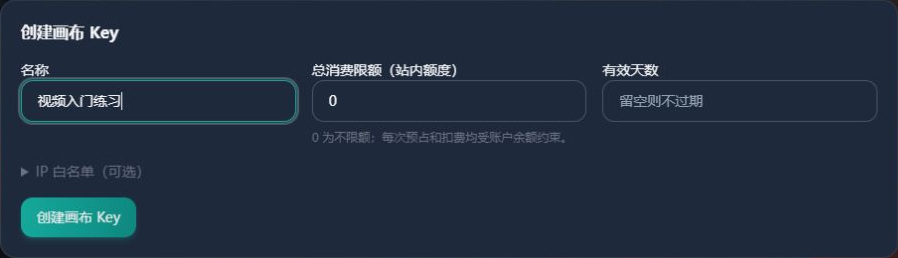
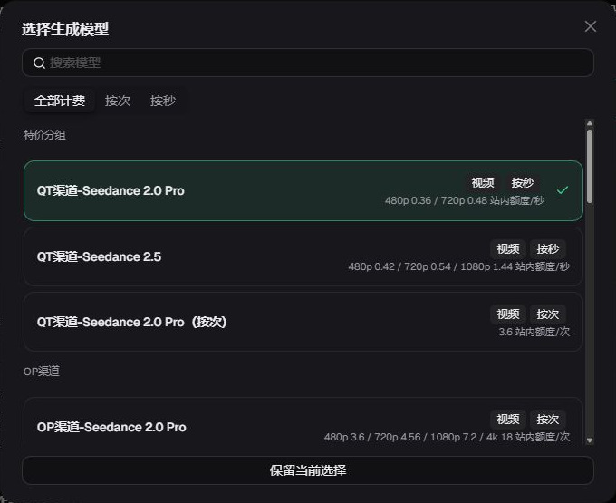
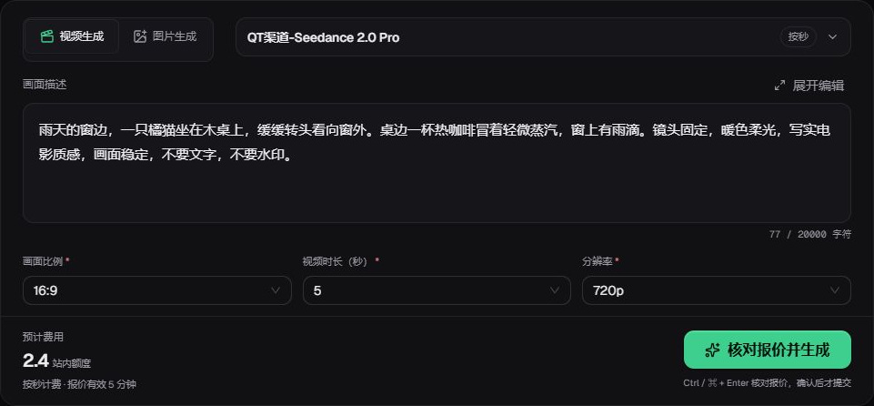
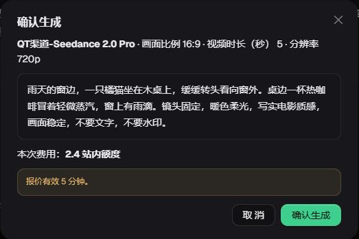
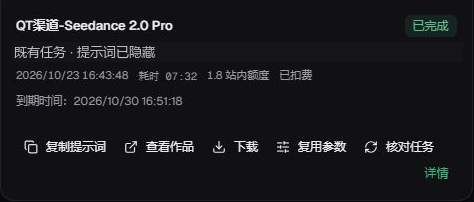
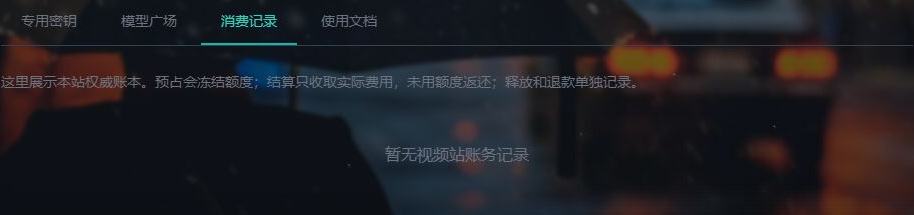

# 在视频站生成第一段视频

归属：视频生成。预览入口：`#track/video`。本课面向第一次使用的普通用户，推荐电脑浏览器。界面核对日期：2026-10-24。

学完能做什么：从本站进入视频站，用文字描述生成一段视频，找到任务、下载作品，并核对消费。本次练习是「雨天窗边的橘猫」，先做一段 5 秒的单镜头视频。

本课路线：**本站侧栏「视频站」→ 创建画布专用 Key → 登录视频站 → 填写描述与参数 → 核对费用并确认 → 查看任务 → 下载与核对消费。**

## 1. 从本站侧栏进入

1. 登录[只因 API](https://www.yydsapi.uno/)，在左侧栏找到「视频站 · 只因 VÉRA」。
2. 点击进入本站的「视频站」页面。这里管理画布专用密钥、查看相关模型和消费记录，右上角「进入画布」通往真正的创作页面。
3. 先查看可用余额。视频站与本站共用同一账户余额，无需给视频站单独转账；创建密钥也不会增加余额。


**完成标志：** 看到「专用密钥」「模型广场」「消费记录」「使用文档」四个标签，以及「进入画布」按钮。

这里用的是[本站视频站](https://canvas.yydsapi.uno/)，与上一课的外部生图 Canvas 是两个入口。

## 2. 创建视频站专用密钥

在「专用密钥」标签下找到「创建画布 Key」，按下面填写：

| 字段 | 首次填写方法 |
| --- | --- |
| 名称 | 例如「视频入门练习」，方便以后辨认 |
| 总消费限额（站内额度） | 按自己愿意用于这把 Key 的累计预算填写；需要覆盖本次报价 |
| 有效天数 | 可按使用计划填写；留空表示不过期 |
| IP 白名单（可选） | 新手保持留空 |

**限额为 `0` 表示不限额，不表示免费。** 限额是这把 Key 能消费的上限；实际生成还要有足够的账户可用余额。这个表单不需要选择 GPT、Claude 或其他分组。

1. 核对填写内容，点击「创建画布 Key」。
2. 在下面的密钥列表中找到「视频入门练习」。
3. 点击该条密钥的「复制密钥」，准备粘贴到视频站登录页。

**完成标志：** 新密钥出现在列表中，并有「复制密钥」操作。剪贴板被覆盖或忘记复制时，可以回到这条密钥再次复制，无需因此删除重建。

这把是**画布专用 Key**。普通「API 密钥」页面创建的聊天或生图 Key 不能代替它；画布专用 Key 也不能用来配置 Codex 或 Claude Code。不要把完整密钥写进提示词、发给他人或留在教学截图里。



图：创建前的真实表单，未提交创建。图中 `0` 表示不限额，不是免费。

## 3. 用专用 Key 登录视频站

1. 在本站视频站页面点击右上角「进入画布」。
2. 确认打开的是 **`https://canvas.yydsapi.uno/`**。
3. 在「画布访问密钥」输入框中粘贴刚复制的专用 Key，点击「登录画布」。

这里用专用 Key 识别它所属的本站账户。无需为视频站再注册一个独立余额账户，也不用填写 Base URL。跳转链接本身不会携带密钥，需要自己粘贴。

如果浏览器已经有有效登录，会直接进入创作页，可以继续下一步。

**完成标志：** 进入创作空间，看到「把想象，变成作品。」以及视频生成表单。余额不足时仍可能登录查看已有内容，但不能据此判断可以生成新任务。

网页中的登录区域是按实际字段名称绘制的 **HTML 字段示意，不是真实登录页截图**。拍摄时浏览器已有有效会话，因此直接进入创作空间。

| 登录字段示意 | 在视频站实际操作 |
| --- | --- |
| 画布访问密钥 | 粘贴自己的画布专用 Key |
| 登录画布 | 点击后验证密钥并进入创作空间 |

本教程不接收密钥，请在视频站实际登录页完成输入。

## 4. 选择模型，填写画面描述

在创作空间选「视频生成」，点击模型名称，在列表中手动选择 **`QT渠道-Seedance 2.0 Pro`**，核对计费方式为 **按秒**。同名的按次版本是另一个选项，不能直接套用它的价格。模型多时可在「搜索生成模型」中搜索 `Seedance`。

页面可能记住上次选择，不要只看默认值。



图：真实模型列表；价格为截图时快照，以自己当前页面为准。

提示词就是你希望视频出现的内容。把下面的描述粘贴到「画面描述」，先用一只猫和一个转头动作完成固定镜头：

```text
雨天的窗边，一只橘猫坐在木桌上，缓缓转头看向窗外。桌边一杯热咖啡冒着轻微蒸汽，窗上有雨滴。镜头固定，暖色柔光，写实电影质感，画面稳定，不要文字，不要水印。
```

接着核对当前表单的三项参数：

| 参数 | 本次练习 |
| --- | --- |
| 宽高比 | `16:9` |
| 时长 | `5 秒` |
| 分辨率 | `720p` |

先完成一段短视频，再学习更长时长或更复杂的镜头。不同模型的可选参数与价格不同；切换模型后，要重新检查参数和报价。5 秒指成品时长，不是等待生成只需 5 秒。

本课使用纯文字生成，不需要上传参考图片、视频或音频。模型介绍中的素材数量不能代替当前页面的实际开放能力。

先不加入多人互动、连续转场和大量动作，便于看清模型是否理解要求。

提示词是创作要求，实际结果仍需检查，不保证每次生成完全一致。



图：生成前的真实表单，已获取报价，未提交生成。

**完成标志：** 选中视频生成和本课模型，填好完整描述，参数为 `16:9 / 5 秒 / 720p`。如果当前模型不可用，先查看页面提示或模型广场，不连续提交。

## 5. 看清费用，再确认生成

1. 查看表单中的「预计费用」和计费说明。本课模型按秒计费，以当前参数对应的报价为准，不照抄截图里的金额。
2. 点击「核对报价并生成」。
3. 在「确认生成」弹窗中，再核对一次**模型、参数、提示词和本次费用**。
4. 确认在自己的预算内，再点击弹窗里的「确认生成」。这一步正式提交任务，可能产生费用。

当前报价有效期为 5 分钟；参数修改、报价过期或价格变化时，按页面提示重新核对。余额足够也不代表 Key 剩余限额足够，两项都需要满足。

提交后先等待，不要连续点击生成，也不要因页面反应慢就创建第二个相同任务。

**完成标志：** 下方「作品与任务」出现这次任务及其状态。出现排队或生成中，说明任务正在处理，还不是生成成功。



图：真实报价弹窗，金额仅为截图时示例。已实际核对报价，未点击最终「确认生成」，未提交本课橘猫视频。

## 6. 等待并核对原任务

如果页面顶部出现「有一项生成提交需要核对」，先点 **「核对原提交」**；已有任务卡时，再用卡片上的 **「核对任务」**。提交结果不明时可能还没有任务卡，不要因此创建第二个任务。

在创作空间下方「作品与任务」查看进度，可切换「视频」并筛选状态；离开页面后，可以从「完整历史」或侧栏「生成历史」找到原任务。查找时可结合生成时间、模型或提示词。

| 页面显示 | 现在应该做什么 |
| --- | --- |
| 排队中 / 正在提交 / 生成中 | 等待原任务更新，不重复生成 |
| 费用核验中 / 保存中 | 继续查看原任务，等待费用或文件处理完成 |
| 已完成 | 查看作品，检查是否可以播放和下载 |
| 已暂停，待核对 / 提交结果不明 | 对原任务点「核对任务」，必要时查看「详情」或联系站方 |
| 生成失败 / 已退款 | 先查看原任务详情及对应账务，再决定是否重新提交 |

网页断线、刷新或超时，不足以判断上游没有收到任务。**结果不明时先核对原任务**，不要复制成新任务反复尝试。

「核对任务」用于查询原任务；「复用参数」会准备一次新的生成，可能再次收费。不要把两个操作混用。

完成后点「查看作品」并播放，检查橘猫、雨天窗景、轻微动作是否出现，视频是否完整、有无明显变形或异常画面。要求不合意时先保存可用结果，再考虑修改提示词；重新生成是一次新的任务，可能再次收费。

**完成标志：** 对应任务显示已完成，作品能够正常播放。只有任务编号、进度或空白预览，都不算获得视频成品。

## 7. 播放、下载，留意到期时间



图：既有视频任务，仅用于定位按钮；原提示词已隐藏，**不是本课橘猫视频的生成结果**。

1. 找到自己的任务，先点击「查看作品」，检查视频是否能正常播放。
2. 在对应作品卡片中点击「下载」。文件尚未就绪或已经过期时，不能当作可下载成品。
3. 打开浏览器下载记录或电脑的「下载」文件夹，找到刚保存的视频。
4. 在电脑中播放文件，确认能完整打开，再按需要重命名并另存，保留实际文件扩展名。

核对时页面提示**「视频仅保存 7 天，请及时下载」**。请同时查看每条作品的「到期时间」，以该条实际显示为准，生成后尽早下载。

历史任务和消费记录保留，不代表视频文件永久保存；文件到期后可能无法播放或下载。站内作品列表不能代替自己的本地备份。

**完成标志：** 视频文件已经保存在电脑上，离开视频站也能播放。

## 8. 共用额度与消费记录

视频作品与任务进度在视频站查看；账务可以在视频站「账户与消费」查看，也可以回到主站的**「视频站 → 消费记录」**核对。不要只到普通模型 API 的「使用记录」里寻找这次视频。

按本次时间和任务核对，不把以下金额直接相加：

| 账务词 | 对用户的含义 |
| --- | --- |
| 可用余额 | 当前还能用于新任务的账户余额 |
| 冻结 / 预占 | 为正在处理的任务暂时保留的额度 |
| 结算 / 扣费 | 对任务确认的实际消费 |
| 释放 / 解冻 | 已完成释放的预占返回可用余额 |
| 退款 | 对已结算消费另行退回的记录 |

视频生成通常先冻结预计费用，再按结果结算。**冻结与结算不是相加收两笔。** 未使用部分会在相应结算或释放完成后回到可用余额；网络报错或任务待核对时，不承诺立即解冻或退款。

本站的其他模型调用也使用同一账户余额，所以视频站的可用额度会随其他消费变化。本课使用账户可用余额，不能用聊天模型的订阅权益替代。

**完成标志：** 能把本次任务与对应费用记录联系起来；若任务或金额仍待核对，保留原任务，停止重复生成并求助。



图：真实账务入口，当前教学账户为空列表，用于说明查找位置，**不是本课消费凭证**。

## 9. 常见问题与小练习

| 现象 | 先检查 |
| --- | --- |
| 找不到视频站入口 | 确认已登录并刷新主站；仍不可见时联系站方 |
| 密钥不能登录 | 是否是本站视频站创建的专用 Key，有无多余空格、停用、到期或 IP 限制 |
| 忘记或没有保存密钥 | 回本站「视频站 → 专用密钥」，在原密钥旁再次点击「复制密钥」 |
| 能登录但无法生成 | 账户可用余额、Key 剩余限额、模型当前可用性、提示词与报价提示 |
| 报价过期或参数变化 | 重新核对报价；已受理的任务去记录中查看，不重新创建 |
| 卡住、断线或提交结果不明 | 找到原任务，使用「核对任务」并查看详情，不连续提交 |
| 完成后找不到作品 | 在「作品与任务」或「完整历史」查找，核对筛选条件和生成时间 |
| 不能下载 | 查看任务是否完成、文件是否就绪及作品到期时间 |
| 看到冻结，以为被扣两次 | 对照同一任务的预占与结算记录；冻结不是额外消费 |

求助时提供发生时间、模型、参数、任务 ID 和脱敏后的报错截图。不要提供完整专用 Key，也不要把本站登录密码发给他人。

### 可选练习：只改变镜头运动

先保存第一段视频。愿意再练一次时，只把「镜头固定」改成「镜头缓慢推进」，其他参数保持一致，比较镜头运动的变化：

```text
雨天的窗边，一只橘猫坐在木桌上，缓缓转头看向窗外。桌边一杯热咖啡冒着轻微蒸汽，窗上有雨滴。镜头缓慢推进，暖色柔光，写实电影质感，画面稳定，不要文字，不要水印。
```

这是一次新的生成，需要重新核对报价，可能再次收费。重新生成也可能改变其他画面细节。

## 编写与验证记录（备课用）

- 主站入口、专用 Key 创建与复制、用途隔离、共享余额与资金状态：`research/video-station/source-audit.md`。
- 线上公开配置：`research/video-station/public-source/site-config.json`；核对时 `generationEnabled=true`，视频保留配置为 7 天。
- 线上模型与参数：`research/video-station/public-source/models.json`；本课使用 `QT渠道-Seedance 2.0 Pro`，首次参数为 16:9、5 秒、720p。当前全部视频模型参考素材未开放，本课仅教纯文字生成。
- 页面文案与任务操作：线上下发的 `generation-form-BcSZMyQv.js`、`task-card-CS0hpeeR.js`、`generate-BIy7a8pD.js`、`history-Bj5Yqx0X.js`；均位于 `research/video-station/public-source/assets/`。
- 已结合真实页面观察与源码核对编写。实际查看了生成表单、模型选择与报价确认弹窗，未点击最终确认。未为教程创建真实密钥、提交付费视频生成、核验真实扣费或下载新生成的视频；步骤中的提示词是可复制练习，不是已完成作品的证明。
- 教学截图位于 `preview/assets/video-generation/`，主站入口图复用 `preview/assets/site-introduction/video-studio.jpg`。账户、余额、完整密钥及任务隐私已遮挡或裁出。`video-task.jpg` 是既有视频任务局部，仅用于说明操作按钮，原提示词已隐藏；`main-billing.jpg` 是当前教学账户的空记录入口，不是本课账单。
- 拍摄时浏览器已有有效会话，未退出重新登录。网页中的登录区域是 HTML 字段示意，按实际字段名称绘制，不标记为真实登录截图。
- 历史交接中的「仅测试主体」「生成未开放」属于旧检查点，不作为当前教程的开放状态依据。费用、权限、模型与保存期限以当前页面为准。
