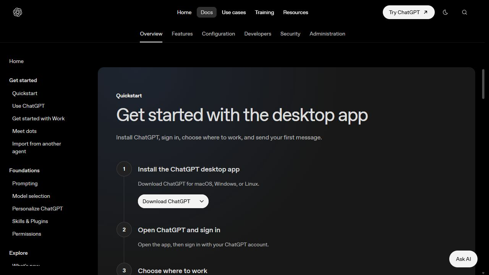
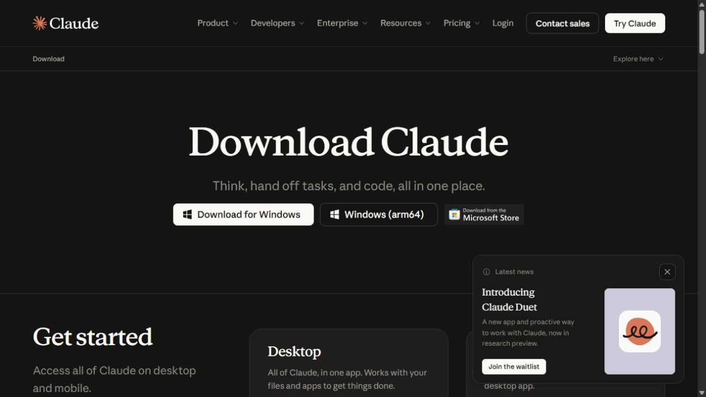
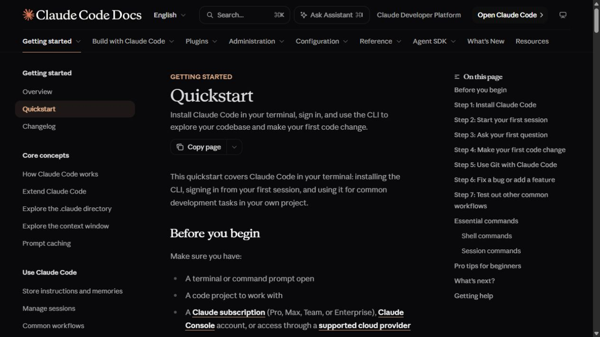
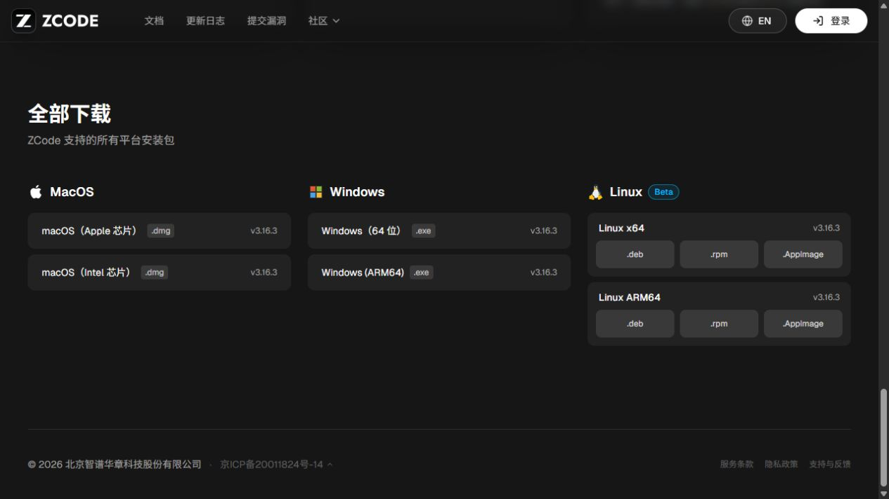
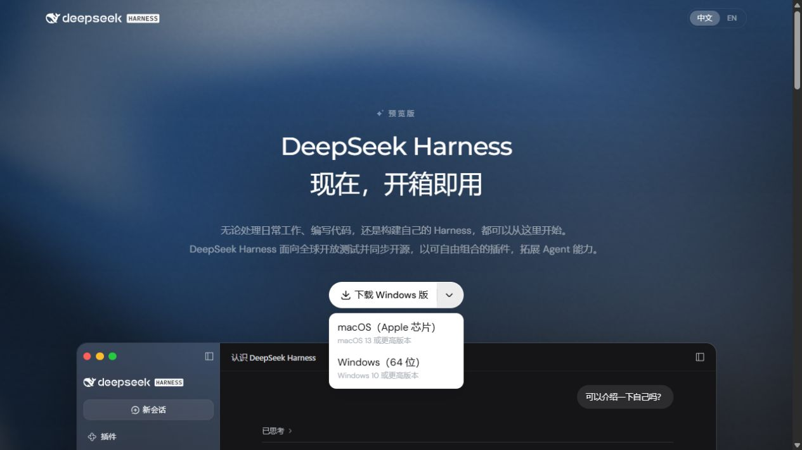
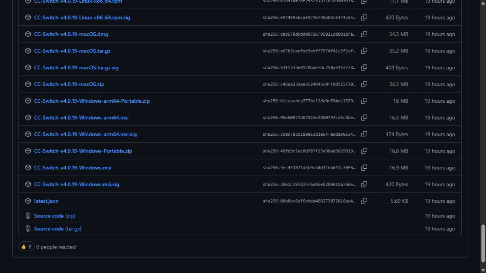

# Agent 入门与工具使用

归属：Agent 与工具。工具目录入口：`#tools`；共用首课入口：`#agent`。面向第一次使用的普通用户，以 Windows 操作为主，资料核对日期：2026-10-24。

本课目标：选一款工具，在电脑“文档”中的 `agent-practice` 练习文件夹创建 `learning-plan.md`，打开检查，再只修改它的标题。使用本站模型时，还要找到对应的使用记录。

正文依据当前网页的 `lesson-agent.js`、`lesson-agent-codex.js`、`lesson-agent-desktop.js`、`lesson-agent-zcode-harness.js` 整理。下载配图为官方网站公开页面实拍，不是本机安装后完成付费任务的截图。

## 一、共用首课：从一句要求，到电脑里的一份文件

### 第 1 步：先认识工具、模型与工作区

Agent 可以围绕一个目标查看文件、执行操作、保存结果，再根据你的要求继续修改。先分清三个概念：

| 名称 | 在本课中的作用 |
| --- | --- |
| 工具 / 客户端 | 你操作的界面，例如 Codex、Claude Code、ZCode、DeepSeek Harness；它组织任务并使用文件等工具 |
| 模型 | 理解要求、生成内容，例如 GPT、Claude、DeepSeek；由当前选中的模型服务提供 |
| 工作区 / 文件夹 | 本次处理文件的位置，本课使用专门的 `agent-practice` |

CC Switch 管理客户端的接入配置。配置好后，需要回到 Codex、Claude Code 或 Claude Desktop 等目标客户端执行任务。

### 第 2 步：选一款工具，完成下载和连接

这一课不要求安装全部工具。喜欢图形界面，可从 ZCode、DeepSeek Harness 或已安装的桌面客户端开始；想使用终端，可选 Codex CLI 或 Claude Code。

| 选择 | 本站教程入口 |
| --- | --- |
| Codex 桌面 / CLI | `#tool/codex` |
| Claude 桌面端 | `#tool/claude-desktop` |
| Claude Code 命令行 | `#tool/claude-code` |
| ZCode | `#tool/zcode` |
| DeepSeek Harness | `#tool/deepseek-harness` |
| CC Switch 配置管理 | `#tool/ccswitch` |

使用本站模型时，在[本站 API 密钥](https://www.yydsapi.uno/keys)准备与模型分组对应的**普通 API Key**。视频生成课中的画布专用 Key 用于视频站登录，本课需要普通 API 凭据。密钥只填写到自己的客户端，不写进提示词或教学截图。

具体地址、协议和模型按工具指南填写。GPT 准备课为 `#gpt`；Claude 与 DeepSeek 在 Claude Code 中的配置课分别为 `#claude`、`#deepseek`。配置完成后回到 `#agent` 继续。

### 第 3 步：在“文档”新建练习文件夹

1. 打开电脑的“文档”。Windows 在空白处右键选“新建 → 文件夹”；macOS 在 Finder 选择“文件 → 新建文件夹”；Linux 在文件管理器中新建。
2. 把文件夹命名为 **`agent-practice`**，首次练习先保持为空。
3. 在 Agent 客户端打开这个整个文件夹，作为本地项目或工作区。命令行工具先从该目录打开终端，再启动工具。
4. 核对客户端显示的项目 / 工作区名称，确认是 `agent-practice`。

已经按工具课建好这个目录时，可以继续使用；如果其中已有 `learning-plan.md`，先保留原文件，换一个空练习位置再做。不要为了重复练习覆盖旧成果。

完成后的目标结构：

```text
文档
└─ agent-practice
   └─ learning-plan.md
```

`learning-plan.md` 后面由 Agent 创建。Markdown 是纯文本格式，本课用记事本也可以查看。

### 第 4 步：发送只读要求，核对目录与权限

把下面的文字发到 **Agent 的任务 / 聊天输入框**，不是发到 PowerShell 提示符：

```text
请先只查看当前工作目录，告诉我文件夹名称和里面有哪些文件。暂时不要创建或修改文件；如果当前目录不是 agent-practice，请先停下来告诉我。
```

它报告的位置不对时，回到工具重新选择文件夹，再继续。权限界面的检查位置：

| 工具 | 首次检查方法 |
| --- | --- |
| Codex | 在输入框附近或 `/permissions` 查看权限；CLI 可用 `/status` 核对状态 |
| Claude Code | 保留 Manual 模式；用 `/permissions` 看规则，写文件前检查具体路径 |
| ZCode | 使用默认“变更前确认” |
| Harness | 按当前权限界面确认工作区和写入操作 |
| Claude 桌面端 | 进入能处理本地文件的 Code 会话，选择 Local、练习目录及 Manual |

出现确认时，先看准备修改的文件和执行的命令。提示词中的目录要求是任务范围说明，实际访问权限仍由客户端设置控制。

**完成标志：** Agent 报告正确的练习目录，你知道后续写入会发生在哪里。

### 第 5 步：创建一份计划，再只修改标题

先把下面的创建要求发到同一个 Agent 输入框：

```text
请先确认当前工作目录是我选中的 agent-practice 文件夹。
在这个文件夹中创建 learning-plan.md，使用中文 Markdown：
1. 标题为“我的 AI 学习计划”。
2. 列出 3 个适合新手的练习：提问、总结、修改结果；每项安排 5 分钟。
3. 每项写出一个具体动作和一个完成标准。
完成后告诉我文件的保存路径，并简要核对它是否满足要求。
若 learning-plan.md 已存在，请先告诉我，不要覆盖。
本次只处理这个练习文件，不需要联网或安装其他软件。
```

如果客户端要求批准写入，核对目标是练习目录中的 `learning-plan.md`。等任务结束，先到电脑上找到并打开文件，检查它真的存在，再做下一次修改。

在**同一条会话**发送下面的追问：

```text
请打开当前练习文件夹中的 learning-plan.md，只把标题改成“我的第一周 AI 学习计划”。
保留原来的 3 项练习与内容。保存后告诉我修改了哪一处，并确认文件仍在原来的位置。
```

任务结束后重新打开文件，标题应该已经改变，原来的 3 项练习仍在。

如果只在聊天里收到了计划文字，可以补充：“请把上面的内容保存为当前练习目录中的 learning-plan.md。保存后告诉我路径。”客户端若停在 Plan / 只读模式，先按工具指南切回允许这次文件写入的模式，再检查确认提示。

### 第 6 步：自己检查磁盘文件和使用记录

到原来的 `agent-practice` 文件夹中，找到 `learning-plan.md`。Windows 可右键“打开方式 → 记事本”；macOS 可用文本编辑或其他文本编辑器。看到 `#`、`-` 等 Markdown 符号属于正常现象。

检查以下内容：

- 文件名是 `learning-plan.md`，没有误存成 `learning-plan.md.txt`。Windows 可以开启“查看 → 显示 → 文件扩展名”。
- 修改后的标题是“我的第一周 AI 学习计划”。
- 仍有提问、总结、修改结果 3 项练习，每项 5 分钟，有具体动作与完成标准。
- 关闭后重新打开，修改仍然存在。

命令行用户也可以从同一文件夹**另开一个 PowerShell 窗口**，执行只读命令：

```powershell
Get-Content -LiteralPath .\learning-plan.md
```

使用本站模型时，到[本站使用记录](https://www.yydsapi.uno/usage)，按任务时间、Key、分组和模型筛选。一个 Agent 任务可能连续请求模型多次，检查和追问也可能产生新用量；记录行数不一定等于你发消息的条数。费用以本站分组计费与记录为准。

使用官方账户或其他供应商时，到对应服务核对消费。CC Switch 管理配置，实际模型费由当前启用的供应商决定。

**完成标志：** 文件能打开，指定修改已保存，调用去向与消费记录清楚。

### 第 7 步：按卡住的位置处理，再继续练习

| 现象 | 下一步 |
| --- | --- |
| 只有回复，没有文件 | 核对工作区与保存路径，明确要求实际保存，再到文件管理器检查 |
| 一直给计划，没有执行 | 检查 Plan / 只读状态、待批准的写入或待回答问题 |
| 文件已存在 | 保留原文件，换一个空练习位置，不直接覆盖 |
| 认证、模型或地址错误 | 回到对应工具课核对供应商、普通 Key 分组、协议、完整模型 ID |
| 没有本站使用记录 | 核对时间筛选和实际供应商，稍后刷新，避免为了找记录不断重发 |

错误码排查入口为 `#track/help`。继续练习时，可以只让 Agent 给每项练习加一个复选框，然后重新打开文件检查。每次提出一个小改动，更容易判断它做对了什么。

## 二、六款工具的具体操作

### 1. Codex：桌面端或 CLI

网页入口：`#tool/codex`。

**下载。** 桌面用户从[官方下载页](https://learn.chatgpt.com/docs/app)选择系统。当前页面标题为 ChatGPT desktop app，应用内有 Codex 入口；部分版本仍使用 Codex 名称。CLI 用户按本站准备课的 Node.js LTS + npm 路线安装，入口 `#gpt?mode=cli&section=gpt-install`。npm 路线在 PowerShell 检查：

```powershell
codex.cmd --version
```

其他官方安装方式使用该方式实际提供的 `codex --version`。

**连接。** 沿用 GPT 准备课中的普通 OpenAI / GPT 文字分组 Key 和 Codex 配置，不重复粘贴其他版本模板。桌面配置入口为 `#gpt?mode=desktop&section=gpt-config`，CLI 为 `#gpt?mode=cli&section=gpt-config`。保存后完整退出、重新打开，并使用新会话核对供应商和模型。

**工作区与任务。** 在“文档”建 `agent-practice`。桌面进入 Codex，打开该本地文件夹，在这个项目中新建聊天，查看权限；CLI 从文件夹地址栏输入 `powershell` 打开窗口，执行：

```powershell
Get-Location
codex.cmd
```

看到 Codex 输入区后再发送 `/status`、`/permissions`，接着依次发送共用首课的三段中文要求。中文任务和斜杠命令发到 Codex；`Get-Location`、启动命令在 PowerShell 中运行。

**成果与费用。** 去原目录打开 `learning-plan.md`，核对创建及标题修改，再按时间、Key 和模型查看本站使用记录。工具费用估算不一定等于本站实扣。

**卡点。** 没写文件先检查当前工作区与写入权限；报告路径与资源管理器路径对不上时，确认是否误选其他项目或云端位置。401、模型权限或流式中断，回 `#gpt?section=gpt-help` 及 `#track/help`。已有文件先保留，用空目录重做。



### 2. Claude 桌面端：独立 3P 配置，再进入本地 Code

网页入口：`#tool/claude-desktop`。

**下载。** 从[Claude 官方下载页](https://claude.com/download)按系统选择。普通 Intel / AMD Windows 选 Windows，Windows on ARM 选 Windows ARM64；macOS 安装包支持 Intel 与 Apple Silicon。Linux 走下载页所列的单独文档。

先认识 Chat、Cowork、Code：Chat 用于对话写作；Cowork 面向多步资料任务；Code 可以选本机项目读写文件。本课使用 **Code → Local**。Cowork 还有系统版本、安装包和虚拟化条件，先完成本地 Code 练习。

**配置第三方推理模式（3P）。** 准备普通 Claude / Anthropic 文字分组 Key。Windows 从登录页左上角 ☰ 菜单进入，macOS 使用顶部菜单栏：

1. `Help → Troubleshooting → Enable Developer Mode`。
2. `Developer → Configure Third-Party Inference…`。
3. 在 Connection 按下表填写。

| 字段 | 值 |
| --- | --- |
| Inference provider | Gateway |
| Gateway base URL | `https://www.yydsapi.uno` |
| Gateway API key | 自己的普通 Claude / Anthropic 分组 Key |
| Credential kind | Static API key |
| Gateway auth scheme | Bearer |

点击 **Apply Changes → Save & Restart**。重启后在登录页选择已有的第三方配置进入，选择本站分组允许的 Claude 模型。不要把本站 Key 填进官方账户登录框。

Claude Desktop 的网关路由由独立 3P 配置管理。Claude Code CLI 的 `~/.claude/settings.json` 和 `ANTHROPIC_BASE_URL` 不能代替本节的 Desktop 设置。

**工作区与任务。** 侧栏进入 **Code**，选择本机 **Local**，再选“文档”中的 `agent-practice`。在权限控件选 **Manual**，旧版可能叫 Ask permissions。Plan 用于先讨论，需要写文件时切回可执行模式。核对项目、模型和路径后，依次发送三段共用提示词。完成后看变更审查，再在电脑目录里打开文件。

**成果与费用。** 使用 3P 本站通道的模型调用按本站规则计费，官方订阅与本站余额分别管理。按任务时间和 Key 核对本站使用记录，不能只看客户端估算。

**卡点。** CLI 配好了但桌面仍用官方账户，回头检查独立 3P 设置。Gateway was unreachable、401 或模型列表为空，检查根地址、Key、分组和网络。配置窗口只读时检查是否受管理员设置管理。恢复官方路线时，完整退出后选择官方登录；使用 CC Switch 管理 Desktop 时可先启用 Claude Desktop Official，再重启。



### 3. Claude Code：命令行中使用 Claude 或 DeepSeek

网页入口：`#tool/claude-code`。

**安装。** 按[官方快速开始](https://code.claude.com/docs/en/quickstart)，在 Windows PowerShell 执行官方原生安装：

```powershell
irm https://claude.ai/install.ps1 | iex
```

安装后重新打开 PowerShell，运行 `claude --version`。出现版本号后再进行本站配置。Git for Windows 是官方建议的 Bash 工具支持，具体系统要求以当次官方说明为准。

**连接。** 同一工具可选择不同模型，但分组与设置需配套：

- Claude 路线：`#claude?section=cc-config`，使用本站 Claude / Anthropic 文字分组 Key。
- DeepSeek 路线：`#deepseek?section=cc-config`，使用本站 DeepSeek 文字分组 Key，并按该课一起设置主模型、别名与辅助模型。

这里不重复旧密钥模板。保存配置后退出旧会话，再从练习目录启动。当前两条准备课使用本站根地址及 `ANTHROPIC_AUTH_TOKEN`，完整设置以所选准备课为准。CLI 配置也不能当作 Claude 网页或 Desktop 官方账户登录方式。

**工作区与任务。** 在“文档”新建 `agent-practice`，从文件夹地址栏输入 `powershell` 打开终端，运行 `Get-Location` 核对目录，再运行 `claude`。进入 Claude Code 输入区后，用 `/status` 核对地址与认证来源，用 `/model` 核对模型，用 `/permissions` 查看规则。保留 Manual 模式，确认练习路径后依次发送三段共用提示词。

**成果与费用。** 在目录里用记事本打开 `learning-plan.md`，检查标题修改和正文保留情况；按任务时间、Key 和模型检查本站记录。辅助处理也可能产生请求，客户端估算不等于本站实际费用。

**卡点。** `claude` 无法识别先重开 PowerShell，再检查官方 PATH / 安装说明。切到 DeepSeek 后仍请求 Claude，核对主模型、别名、辅助模型以及分组 Key，重开会话再看 `/status` 与 `/model`。普通聊天可用但文件工具报错时，还要核对具体模型和客户端工具兼容性。



### 4. ZCode：自定义 Anthropic 供应商

网页入口：`#tool/zcode`。

**下载。** 从[官方安装页](https://zcode.z.ai/cn/docs/install)选择 Windows x64 / ARM64、macOS Apple Silicon / Intel，或 Linux 对应安装包。安装后点击“开始使用 ZCode”，可先跳过数据迁移。

**配置。** 初次没有模型时点左下角“连接使用 → 使用 API Key”；已进入应用则点对话中的模型名称 → 管理模型 → 设置 → 模型设置。在供应商列表底部点“添加供应商”，按本课的 Claude 路线填写：

| 项目 | 填写值 |
| --- | --- |
| 名称 | 只因 API · Claude |
| Anthropic 接口地址 | `https://www.yydsapi.uno` |
| API Key | 自己的普通 Claude 分组 Key |
| 添加模型 → 模型 ID | `claude-sonnet-4-6`，以这把 Key 可用模型为准 |

保存供应商，添加精确模型 ID，开启“启用”，再从对话模型选择器选中本站通道。基础地址不粘贴完整 `/v1/messages`。

官方支持 Anthropic / OpenAI 兼容自定义供应商；不同字段的基础地址约定不完全相同。换 GPT 或 DeepSeek 时，要一起核对分组、协议、地址和模型，不能只换名称，也不要把所有地址统一增删 `/v1`。

**工作区与任务。** 选择“文档”里的 `agent-practice`，也可从左侧顶部搜索入口找到“打开文件夹”。保留默认“变更前确认”，依次发送共用三段要求。完成后点击工作区卡片的“文件树图标 / 查看文件”，单击 `learning-plan.md` 在右侧预览，再到电脑目录确认。

**成果与费用。** 供应商保存与启用后，还要通过短任务、文件结果及本站记录核对。一次任务可能产生多条模型请求。

**卡点。** 模型不显示先看供应商是否启用和是否添加模型。400 检查模型、协议与推理设置。Windows 关闭窗口可能只是隐藏到托盘，重启前应完整退出。ZCode 的代理留空不等于跟随系统代理，修改代理后需重启应用。



### 5. DeepSeek Harness：自定义模型 API

网页入口：`#tool/deepseek-harness`。

**下载。** 从[官网](https://www.deepseek.com/harness/)下载桌面端；本轮看到 Windows 64 位（Windows 10+）及 macOS Apple 芯片（macOS 13+）。当前仍是预览版，选项以官网为准。

另一条官方路线是本机 Web UI：先安装 Node.js，从练习目录的 PowerShell 运行：

```powershell
npx.cmd @deepseek-ai/dsh web
```

按 npm 提示获取官方包，打开终端打印的地址，默认 `http://127.0.0.1:3080`。使用期间保留终端运行。下面字段以官方 Web UI 文档为依据，桌面版需按当前界面对照。

**配置。** 打开“设置 → 模型 → 添加模型提供商”，从默认“第三方模型提供商”切到 **自定义模型 API**：

| 字段 | 填写值 |
| --- | --- |
| Provider ID | `rainapi`，小写固定标识 |
| 显示名称 | 只因 API · Claude |
| API 地址 / 基础 URL | `https://www.yydsapi.uno` |
| API 协议 | Anthropic Messages |
| API 密钥 | 自己的普通 Claude 分组 Key |
| 模型 ID | `claude-sonnet-4-6`，以这把 Key 实际权限为准 |

至少添加一个模型再保存。Provider ID 用于会话与模型引用，后续不要随意改名。保存后回会话模型选择器选中本站模型。

“获取可用模型”可用于获取目录，失败或空列表时可以手动添加精确模型 ID。保存配置、认证状态变绿或获取到列表，不代表已经实际完成推理请求。

协议选项有 OpenAI Chat Completions、OpenAI Responses、Anthropic Messages。一个提供商只用一种协议；使用本站 Chat Completions 路线时，网页示例基础地址为 `https://www.yydsapi.uno/v1`，配套对应分组与模型。需要 Responses 时显式选该协议。工具名含 DeepSeek，不代表本站 Key 应填在默认官方 DeepSeek 卡片。

**工作区与任务。** 点“选择工作区”，添加并选中“文档”里的 `agent-practice`，再新建会话。即使 Web UI 从该目录启动，全新的界面仍需显式选择工作区；未选工作区或模型时输入框可能不可用。依次发送三段共用要求，按当前策略检查写入确认。

**成果与费用。** 到实际目录打开 `learning-plan.md`，检查标题和正文，再核对本站调用记录。模型设置在下一次请求生效，不需重启服务；新建会话可避免旧会话保留自己的模型设置。

**卡点。** `MISSING_CREDENTIAL` / 401 检查对应自定义提供商保存的 Key；`UNKNOWN_MODEL` 补齐模型目录并重新选择。输入框不可用先选工作区与模型。Web UI 打不开先检查启动终端及实际地址；关闭服务终端后页面会失去连接。



### 6. CC Switch：导入、启用，再回目标客户端

网页入口：`#tool/ccswitch`。

**下载。** 从[官方 Releases](https://github.com/farion1231/cc-switch/releases)选择标记 Latest 的正式版，展开 Assets。Windows 选择对应 x64 / ARM64 的 `.msi` 或 Portable 压缩包；macOS 选择 Universal `.dmg`；Linux 按发行版与架构选包。Source code 是源码。目标 Agent 客户端也需要先安装。

**从本站导入。**

1. 到[本站 API 密钥](https://www.yydsapi.uno/keys)，找到与目标模型分组匹配的普通 Key。
2. 点该行“导入到 CCS”，在浏览器提示中打开 CC Switch。
3. 检查导入窗口的目标客户端、本站域名、模型和供应商名称，再确认导入。
4. 在 CC Switch 正确的客户端页找到这张卡，点“启用”，确认显示“使用中”。只保存卡片不等于切换。
5. 按目标客户端要求完整重启或新建会话，并核对当前模型。

**导入目标必须分清：** 本站 OpenAI 分组通常导入 Codex，Claude 分组导入 Claude Code；其他分组按对应客户端处理。这里的 Claude Code 不是 Claude Desktop。本站现有一键导入没有直接导入 Desktop 的分支。

一键导入不能唤起应用时，先确认 CC Switch 已安装并运行；仍失败可在正确客户端页用“添加供应商 → 自定义配置”。地址、Key、模型与协议按 `#tool/codex` 或 `#tool/claude-code` 的准备课核对，不把不同服务商的模板混用。

**Claude Desktop 单独配置。** 在 CC Switch 左侧选 Claude Desktop；没有该项时到“应用”页显示。可以从已有 Claude Code 供应商导入后逐项检查，也可新建自定义供应商：

| 项目 | 填写或选择 |
| --- | --- |
| API 请求地址 | `https://www.yydsapi.uno` |
| API Key | 自己的普通 Key，与模型分组匹配 |
| 接入方式 | 原生兼容 Claude 可直连；需转换模型或协议时用模型映射 |
| 实际请求模型（映射） | 本站分组确实支持的完整模型 ID |
| 上游格式（映射） | 按本站协议选择；本课 Claude 路线为 Anthropic Messages |

模型映射的“菜单显示名”用于辨认，“实际请求模型”才是发给本站的 ID。保存并启用后，完整退出重开 Claude Desktop；映射通过本地路由转发，使用时保持 CC Switch 运行。也可选择官方 3P Gateway 表单路线，详见 `#tool/claude-desktop?section=agent-connect`，不需要同时叠加两套配置。

**工作区与任务。** 回到真正启用的 Codex、Claude Code 或 Claude Desktop，打开“文档”里的 `agent-practice`。在目标客户端发送共用提示词，完成文件检查。CC Switch 自身不执行本课文件任务。

**成果与费用。** 先核对卡片“使用中”，再检查客户端文件结果与本站使用记录。余额查询、连通检测和本地费用估算与模型推理是不同环节，实际模型费以供应商记录为准。

**卡点与恢复。** 导入后仍用旧服务先看是否启用、是否选错客户端页、是否需要重启；Windows 和 WSL 也可能使用不同配置目录。Desktop 映射失败检查 CC Switch 是否在运行、路由状态、上游格式和实际模型。恢复原配置时，在正确客户端页启用原供应商或 default；恢复 Desktop 官方账户时启用 Claude Desktop Official，再重启并按官方登录。



## 三、官方来源与编写边界

### 来源

- Codex：[桌面应用](https://learn.chatgpt.com/docs/app)、[CLI](https://learn.chatgpt.com/docs/codex/cli)、[本地项目](https://learn.chatgpt.com/docs/projects)、[权限模式](https://learn.chatgpt.com/docs/permission-modes)。
- Claude Code：[快速开始](https://code.claude.com/docs/en/quickstart)、[权限](https://code.claude.com/docs/en/permissions)、[网关接入](https://code.claude.com/docs/en/llm-gateway-connect)、[模型配置](https://code.claude.com/docs/en/model-config)、[DeepSeek 集成说明](https://api-docs.deepseek.com/quick_start/agent_integrations/claude_code)。
- Claude Desktop：[官方下载](https://claude.com/download)、[3P 概览](https://claude.com/docs/third-party/claude-desktop/overview)、[Gateway 字段](https://claude.com/docs/third-party/claude-desktop/gateway)、[应用内第三方配置](https://claude.com/docs/third-party/claude-desktop/in-app-configuration)、[Code 本地会话](https://code.claude.com/docs/en/desktop-quickstart)。
- ZCode：[安装](https://zcode.z.ai/cn/docs/install)、[连接模型](https://zcode.z.ai/cn/docs/configuration)、[Agent 工作流](https://zcode.z.ai/cn/docs/agents)、[文件管理](https://zcode.z.ai/cn/docs/task-management)。
- DeepSeek Harness：[官网](https://www.deepseek.com/harness/)、[README](https://github.com/deepseek-ai/deepseek-harness/blob/master/README.zh.md)、[快速开始](https://deepseek-harness.github.io/deepseek-harness/guide/quickstart)、[模型配置](https://deepseek-harness.github.io/deepseek-harness/guide/providers)。
- CC Switch：[官方仓库](https://github.com/farion1231/cc-switch)、[Releases](https://github.com/farion1231/cc-switch/releases)、[添加供应商](https://github.com/farion1231/cc-switch/blob/main/docs/user-manual/en/2-providers/2.1-add.md)、[Claude Desktop](https://github.com/farion1231/cc-switch/blob/main/docs/user-manual/en/2-providers/2.6-claude-desktop.md)、[深链导入](https://github.com/farion1231/cc-switch/blob/main/docs/user-manual/en/5-faq/5.3-deeplink.md)。

### 编写与验收边界

当前教程已核对官方入口、文档字段及本站相关配置 / 导入源码；复用前面 GPT、Claude、DeepSeek 的配置课。官方文档支持自定义 API，不等于本轮已经完成本站客户端联调。

本课没有安装这些客户端、将真实 Key 写入配置、执行启动安装命令或发起付费 Agent 文件任务。下载图是官方网站公开页面实拍；首页的成果卡片和文件结构图是教学目标示意。Harness 配置步骤按官方 Web UI 文档整理，桌面版仍需逐项对照当前界面。

工具版本、系统条件、分组权限、模型工具能力与费用可能变化。实际验收需记录工具版本与系统，核对脱敏后的地址、协议和模型，完成真实文件创建 / 修改，并用对应服务的使用记录确认调用。保留既有成果，密钥始终在用户自己的客户端填写。
