# 费用与账户：看懂额度、消费和到账

归属：费用与账户。预览入口：`#track/billing`。界面与规则核对日期：2026-10-24。适合第一次使用本站、想知道钱在哪里看和问题怎么查的用户。

学完这一课，你能分清账户余额、订阅额度和 Key 限额，找到充值、消费、订单和安全设置的位置，并知道怎样核对结果。本课先完成不花钱的找入口练习；真实充值、兑换、退款、开票和安全设置留到你确有需要时再按步骤操作。

## 1. 先分清三件事：余额、订阅、Key 限额

登录[只因 API](https://www.yydsapi.uno/)，先打开「仪表盘」「我的订阅」和「API 密钥」，认清它们分别管理什么。

| 名称 | 它是什么 | 去哪里看 |
| --- | --- | --- |
| 账户余额 | 本站账户可用于余额计费服务的额度 | 仪表盘、个人资料及相关消费页面 |
| 订阅额度 | 某个订阅分组在有效期内，按套餐规则提供的用量 | 我的订阅 |
| Key 限额 | 你给某一把密钥加上的消费限制，包括累计上限和周期上限 | API 密钥 |

**创建 Key 不会增加余额，给 Key 填一个限额也不等于充值。** 账户有余额，仍可能因为 Key 已过期、停用、达到上限或没有对应分组权限而无法使用。

普通标准分组按账户余额收费。订阅分组需要这把 Key 所属分组的有效订阅；订阅用完后不会自动改扣余额。反过来，标准分组 Key 也不会自动寻找账户里的其他订阅来支付。

**这次看懂的标志：** 你能说出准备使用的 Key 属于哪个分组，以及这条路线使用余额还是对应订阅。

## 2. 使用前看价格，使用后看实际费用

入口：[模型广场](https://www.yydsapi.uno/model-plaza)。登录后先选自己要用的分组，再搜索模型。

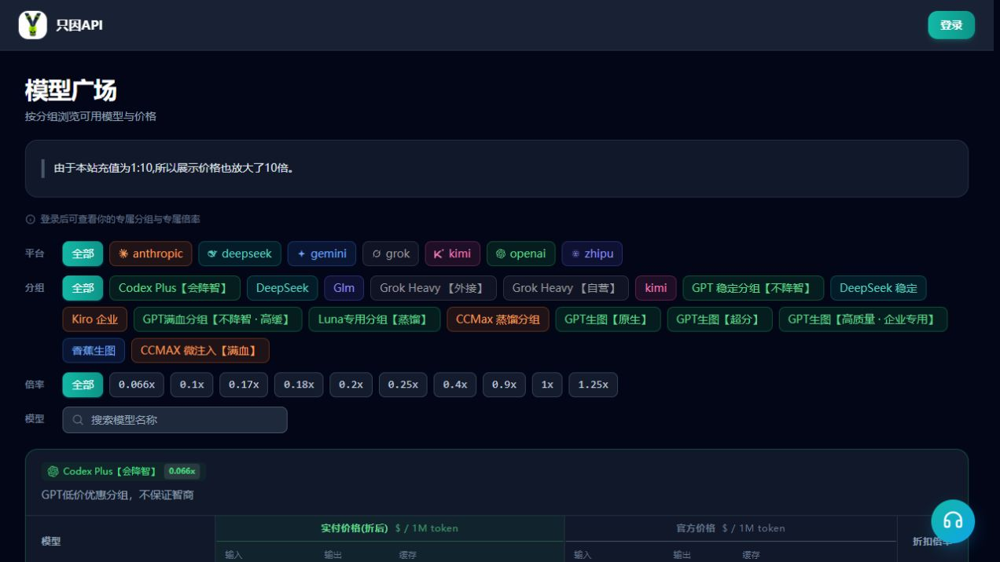

看价格时，按这个顺序核对：

1. **分组和模型：** 名称相似的不同分组，价格、权限和可用服务可能不同。
2. **计费单位：** 按 Token、按次、按图片或视频对应规则计费，含义不同。
3. **实付价格与说明：** 看「实付价格（折后）」及当前档位、时段等说明；「官方价格」属于参考信息。
4. **实际费用：** 使用后到对应记录里核对本站记下的费用。

| 计价方式 | 第一次看时抓住什么 |
| --- | --- |
| 按 Token | 输入、输出、缓存可能分别计价；1M Token 表示一百万个 Token，不能把所有 Token 都乘同一个单价 |
| 按次 | 看清每个收费单位指什么；一次工具任务可能发送多次请求 |
| 图片 | 看所用模型、张数、尺寸和计费方式；生成图片也可能按 Token 计费 |
| 视频 | 看当前报价中的模型、时长、分辨率和数量；成品时长与等待生成的时间不同 |

模型广场的「实付价格（折后）」已计入页面对应的有效倍率。使用记录里的「费用」及明细中的「用户扣费」也已经完成计价，**不要再乘一次倍率**。明细中的「原始」是计算过程中的另一项数值，不是你还要额外支付的第二笔钱。

本站页面仍可能出现 `$`、USD 或历史比例说明。**不能只凭一个符号就认定支付币种是美元，也不能据此推导固定充值比例。** 付款看当前支付页的币种与实付金额，到账看订单，模型使用看当次费用记录。若说明、报价和订单含义对不上，先向站方核实再付款。

订阅计费的请求也可以有费用记录：这笔费用用于消耗订阅额度，不代表又从余额扣了同样一笔。Key 限额同步累计同一笔费用，也不是再次收费。

## 3. 充值：先看清实付，再确认到账

入口：左侧「充值/订阅」→「充值」。菜单可能按当前开放模式显示为「充值」或「订阅」。

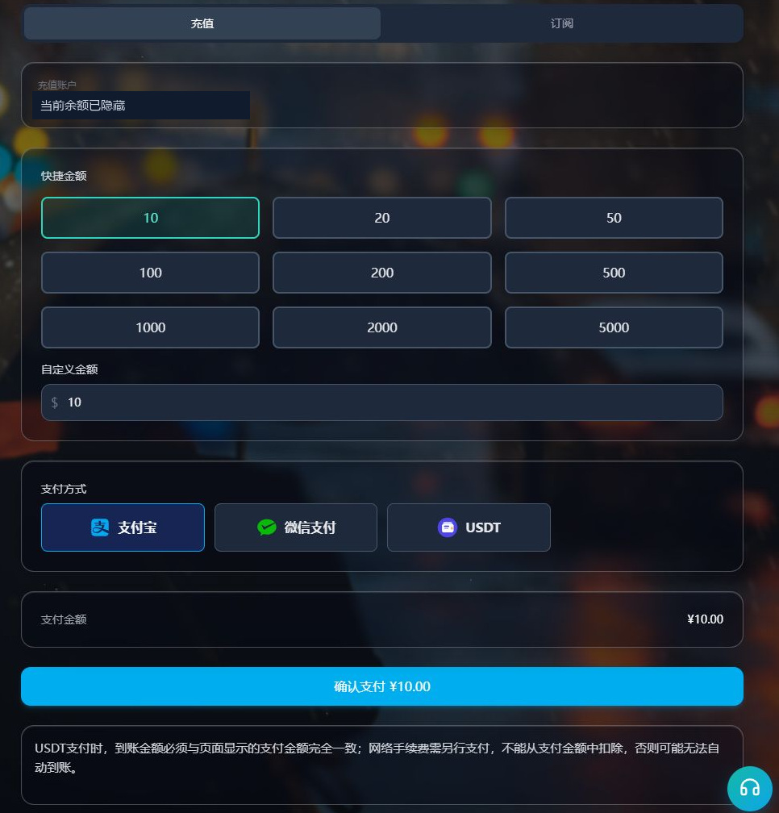

图：确认支付前的真实表单，未创建订单、未支付。

真正需要充值时，再按下面操作：

1. 确认页面显示的是自己的账户。
2. 选择快捷金额，或输入自定义金额；按当前支付方式的上下限填写。
3. 选择页面实际列出的可用支付方式。
4. 核对摘要中的实付、手续费、到账余额和赠额。
5. 确认符合自己的预算后，点击「确认支付」并在支付工具完成付款。这个按钮会创建订单，不用于本课的找入口练习。

| 金额名称 | 怎样理解 |
| --- | --- |
| 实付金额 | 这次实际向支付渠道支付的金额，连同币种一起看 |
| 手续费 | 支付方式可能收取的费用，不等于增加的站内余额 |
| 到账余额 | 订单为本站账户增加的额度，按本次报价和订单结果核对 |
| 赠额 / 折扣 | 当前活动提供的权益，适用对象和条件可能不同 |

不要用截图里的金额或其他用户的活动档位代替自己的报价。首充、学生专享或特定支付方式的规则，以当前实际出现的页面为准。

完成付款后，回到本站打开「我的订单」，找到原订单：

| 订单状态 | 接下来做什么 |
| --- | --- |
| 待支付 | 本站尚未记录付款完成；支付工具已扣款时，先刷新原订单核对 |
| 已支付 / 充值中 | 付款确认或到账还在处理，继续查看原订单 |
| 已完成 | 刷新账户余额，核对该订单的到账额；订阅订单另查我的订阅 |
| 失败 / 已过期 / 已取消 | 先确认支付工具是否实际扣款，再带原订单信息核对；这些状态本身不能证明已经退款 |

**到账完成标志：** 原订单显示「已完成」，刷新后能核对对应余额或订阅权益。支付页的大绿勾或“支付成功”标题，可能仍处于到账处理阶段。

支付工具已扣款而本站未完成时，保留订单号、付款时间、实付金额和币种，刷新原订单并联系站方核对。不要为解决“页面没更新”又付一笔。如果同时有任务在消费或冻结额度，余额净变化还要结合同期记录检查。

### 3.1 用 USDT 充值：额外赠送1%，先分清应转数量和费用

本站 **USDT 普通余额充值额外赠送1%**。在「充值/订阅 → 充值」填写金额并选择 USDT 后，先看「赠送额度 (+1%)」和「到账余额」。**到账余额已经包含本次赠金，不要再加一次1%。**

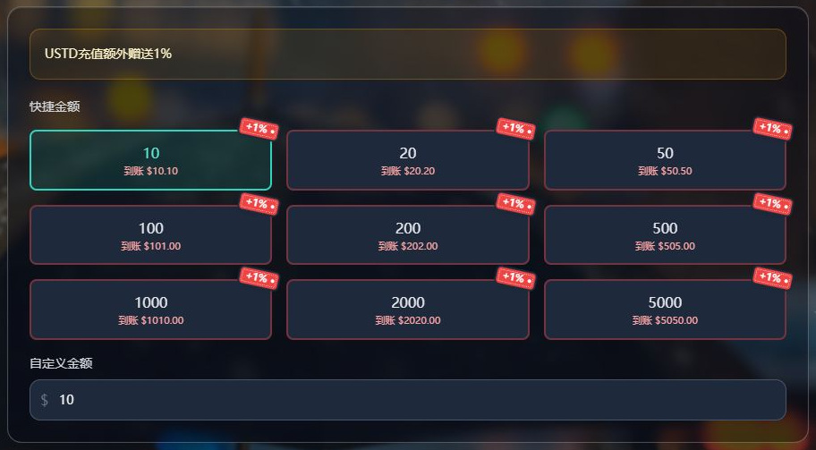

图：付款前真实表单预览，未提交订单、未生成收银台；不是转账或余额已到账的凭证。

最关键的一步是：**钱包或交易所最终显示的「对方到账 / 实际到账」，要精确等于本单收银台要求的 USDT 数量。** 网络费如何收、使用哪种币、从哪里扣，都按你使用的平台最终确认页处理。

准备真正付款时，按下面顺序核对：

1. **先核对本站的赠金和到账预览。** 赠送按本单站内基础到账额的1%计算，并按订单精度处理；不是按链上转出的 USDT 数量或钱包总支出直接加1%。
2. **选择支付网络，两端保持一致。** 本次界面可选 BSC（BEP20）与 TRC20，实际可用项以当前页面为准。之后钱包转账或交易所提币也要选择同一网络，不能只核对币名。
3. **确定要付款时，再创建订单并打开本单收银台。** 由你自己点击「确认支付」，核对新订单收银台的币种、网络、收款地址、精确数量和有效期。本站表单中的「支付金额」与收银台换算后的 USDT 数量分开看，不从旧订单、截图或聊天记录复制支付信息。
4. **在转出平台核对扣费方式和对方到账。** 如果平台从填写的提币数量中扣网络费，按平台提示调整发送数量，让最终「对方到账」恰好等于收银台应收数量。如果费用另扣，按收银台数量转账并另备费用，不要又把网络费加进给收款方的数量。费用也可能使用其他币种，币种、数量和扣取方式都看最终确认页。
5. **转出后查原订单，再核对本站余额。** 保留链上交易编号和原订单信息，等待原订单显示「已完成」，再刷新核对对应到账余额；1%赠金随本单发放。暂未到账先查原单与转账状态，不重复付款。

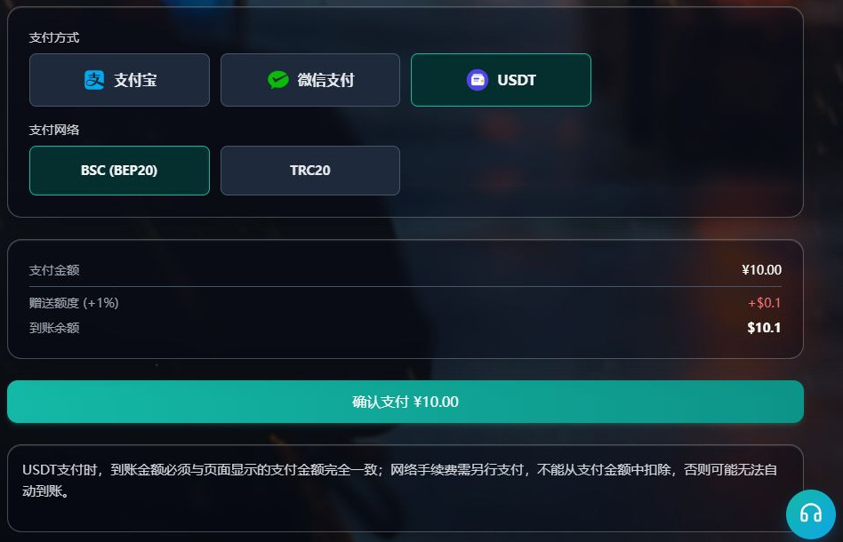

图：选择支付网络和核对金额的付款前界面，未提交订单、未生成收银台；图中不是实际应转 USDT 数量，也不是已付凭证。

把这几种金额分开看，就不容易多转、少转或重复计算：

| 金额或费用 | 含义与核对位置 |
| --- | --- |
| 本站支付金额 / 实付 | 本站订单的付款金额，连同币种看；不能把相同数字直接填成 USDT 数量 |
| 收银台应收 USDT | 这笔订单收款方需要实际收到的精确数量，用钱包或交易所的「对方到账」核对 |
| 钱包 / 交易所网络费 | 转账或提币费用，可能另扣，也可能从转出数量中扣；按平台最终说明处理，不套固定数值或币种 |
| 本站通道手续费 | 若本站金额摘要有手续费行，按本单实付核对；它与钱包网络费不同，不要重复添加 |
| 赠送额度 (+1%) | 按站内基础到账额计算的赠金，不是需要多转给收款方的 USDT |
| 本站到账余额 | 本单最终增加的站内余额，已含本次赠金；不再加1%，网络费也不计入余额 |

**怎样读本次截图的10、0.1和10.1：** 真实表单预览显示「支付金额 ¥10.00」「赠送额度 (+1%) +$0.1」「到账余额 $10.1」。到账预览已经含赠金，符号按原界面保留，不能据此认定美元或固定汇率。这不是“转10 USDT 得到10.1”的报价，也没有发生实际充值到账；真正应转的 USDT 数量要在新建的那笔订单收银台查看。

上述1%适用于 USDT 普通余额充值。订阅、学生专享和首充礼包分别按自己的规则核对，**不默认叠加赠送**。当前预览未显示赠金或金额不符时，先向站方核实，不自行多转；订单创建时的到账额和赠金按该单固定，之后活动变化不能拿来重算原订单。

**看懂的标志：** 付款前能分别指出收银台应收 USDT、钱包网络费、本站实付、赠金和本站到账余额；真正付款后，再以原订单已完成和余额更新核对结果。本课无需创建订单或转账。

## 4. 订阅：认准分组、期限和每项额度

入口：「充值/订阅」→「订阅」用于查看当前可购买的套餐；「我的订阅」用于查看已经拥有的订阅。

**2026-10-24 本次核对时，订阅购买页显示暂无可用套餐。** 因此本课先学习怎样识别已有订阅；以后需要购买时，查看当时是否有套餐及其规则。

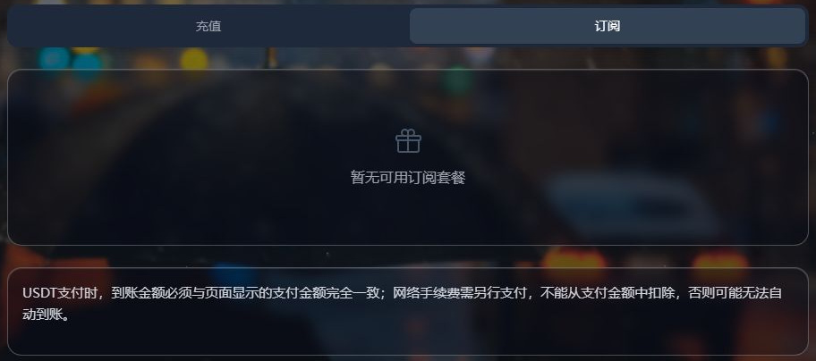

在「我的订阅」中，对照这四项阅读卡片：

1. **属于哪个分组：** 要与准备使用的普通 API Key 所绑分组对应。
2. **状态和到期时间：** 有效期结束后，单看额度还有剩余也不能继续使用。
3. **各项已用与上限：** 有每日、每周、每月限制时，每项都要满足；每日有剩余不代表其他周期也有剩余。
4. **倒计时和套餐说明：** 区分“后重置”和“额度将在……后结束”。短期套餐可能是一份到期结束的额度。

不同期限的窗口规则可能不同。**不要统一按每天零点、每周一或每月1日推算**，也不要把“每月”直接理解为自然月。按当前套餐规则、到期时间和页面倒计时核对；倒计时结束后刷新页面再看。

卡片显示“无限制”，只表示没有列出的用量上限，不免除有效期、Key、分组和模型等限制。续费按钮通往购买流程，点击进入页面不等于续费已经完成。

**完成标志：** 能找到对应分组的订阅卡片，并指出它何时到期、哪项额度需要先关注。没有套餐或没有订阅时，认清当前空状态也算完成本节。


## 5. Key 限额与有效期：给凭据加一道预算限制

入口：左侧「API 密钥」。本节讨论普通聊天、Agent 或外部生图使用的普通 Key；视频站的画布专用 Key 按视频教程管理。

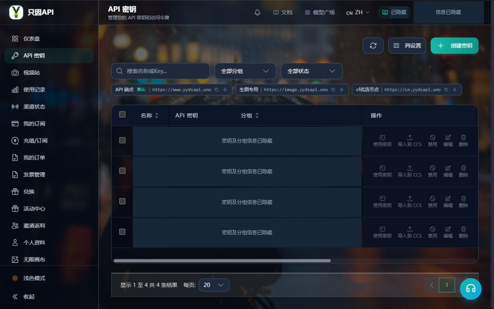

| 字段 | 应该怎么读 |
| --- | --- |
| 分组 | 这把 Key 走哪组服务及收费规则，决定应检查哪份订阅或账户余额 |
| 今日 / 总计 | 按这把 Key 汇总的实际消费统计 |
| 额度限制 / 已用额度 | 这把 Key 的累计消费上限和限制计数，与账户余额不同 |
| 速率限制 | 5小时、日、7天等窗口内的消费金额上限，实际窗口看列表倒计时 |
| 过期时间 | 这把 Key 的实际期限；保存设置后回列表核对 |
| 状态 | 活跃、已停用、额度耗尽、已过期分别排查 |
| IP 限制 | 限定允许或禁止使用这把 Key 的网络来源；不了解自己的出口 IP 时先了解规则再设置 |

**限额为0表示这项不设限制，不表示免费。** 页面里的“速率限制”在这里控制的是消费金额，不是每分钟请求数。多个限制同时启用时，任何一项用完都可能阻止继续调用。

更换同账户的 Key 不会给账户充值，原来的消费记录仍在。另一把 Key 可以有自己的限制计数，也可能绑定不同分组，所以换用后要重新核对分组、模型和收费规则。

编辑页中的“重置已用额度”只把这把 Key 的总限额计数归零；“重置速率限制用量”只重置它的周期计数。这些操作不会增加余额、返还费用或延长订阅。Key 的限制计数与历史总消费因此可能不同，本课只需认清含义，无需点击重置。

**完成标志：** 你能在列表指出一把 Key 的分组、状态、期限和额外限制，并知道它们与账户余额分开管理。

## 6. 消费记录：先按使用入口找对账本

同样是生成内容，记录入口可能不同。先回想这次从哪里使用，再按表查找：

| 做过的事情 | 先去哪里查 |
| --- | --- |
| 通过本站普通 Key 聊天，或使用 Codex、Claude Code 等工具 | 使用记录 |
| 按图片首课，通过外部 Canvas 和普通生图 Key 生图 | 使用记录 |
| 从本站「视频站」进入画布，用画布专用 Key 生成 | 本站视频站 → 消费记录，并结合原任务查看 |
| 充值或购买订阅 | 我的订单；已购订阅权益再查我的订阅 |
| 兑换、领取活动奖励或转入返利 | 对应兑换/活动/返利页面的结果，再核对账户权益 |

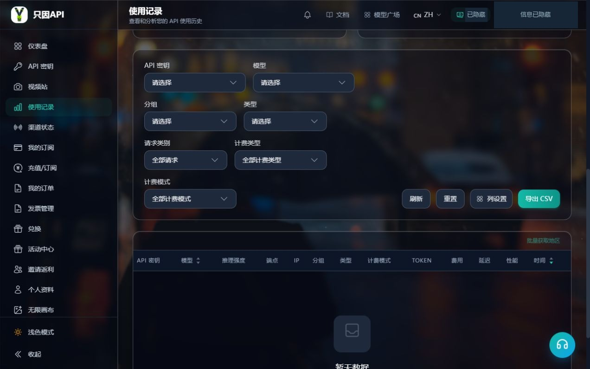

在「使用记录」里查一笔普通调用：

1. 选择发生请求的日期范围。
2. 按 Key 名称、模型和分组筛选；找不到时先清除多余条件。
3. 核对时间、模型、计费类型和费用。费用旁的信息入口可查看明细。
4. 查看「用户扣费」，并分清这次是余额计费还是消耗订阅额度。

一次聊天操作或 Agent 任务可能包含多次模型请求，不能只找一条就断定总费用。客户端自己的估价也可能与本站记录不同。

视频任务先查原任务和视频站消费记录。若出现冻结、结算或退回等条目，按同一任务的后续记录核对；冻结是执行阶段的预占，不能简单与最终费用相加当成扣了两次。等待任务结束、任务成功和账务结算也是不同状态。

**找不到记录时：** 先核对登录账户、日期、筛选和实际使用入口，再刷新。空列表或客户端报错本身，都不能证明没有产生请求或费用。

## 7. 我的订单、退款和发票

### 查订单

入口：左侧「我的订单」。先按状态筛选，结合列表中的创建时间、订单编号和翻页找到原单，核对类型、实付、到账、赠额和状态，再用刷新查看最新结果。

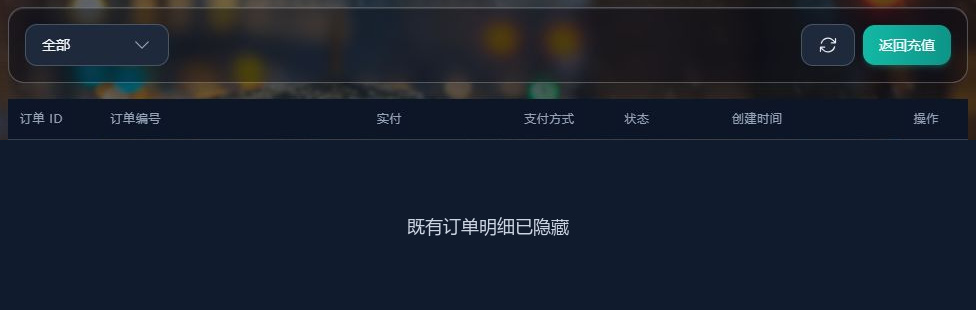

待支付订单可能有「取消订单」，符合条件的订单可能有「申请退款」。取消待支付订单不等于退回已经支付的钱；也不要假定每条订单都有“继续支付”按钮。

### 需要退款时

打开原订单，若有「申请退款」，按页面填写原因并提交，再查看订单后续状态。这个操作只提交申请，**“退款申请中”不等于已经退回支付工具**。

普通用户自助退款针对符合条件的普通余额充值订单，还要求本人订单已完成、历史支付渠道允许、当前余额足以覆盖该单到账额等条件。订阅、首充礼包和活动赠额不能套用同一退款承诺；按钮可见也仍需通过实际资格检查。

后续按订单状态及原支付工具的退款记录核对结果。没有入口、资格不符或状态迟迟未更新时，带原订单信息向站方咨询，退款金额和时间按实际处理结果确认。

生成任务失败后的站内账务调整，与充值订单退款是不同流程。失败、取消或点击重试都不保证免费，也不保证退款；先查原任务和记录，再决定下一步。

### 需要发票时

入口：左侧「发票管理」→「申请发票」。

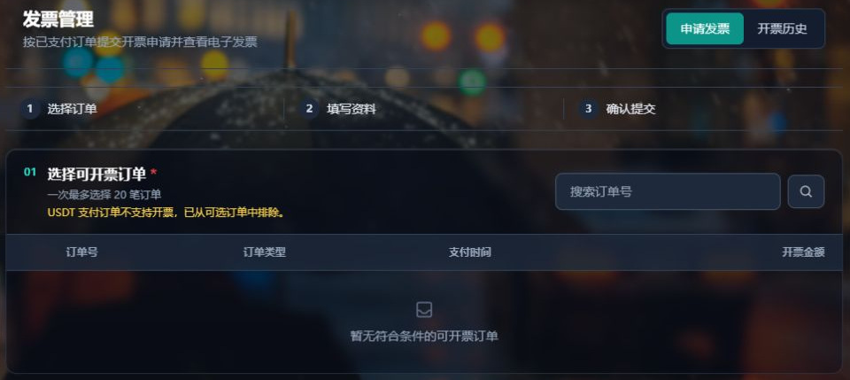

1. 在可开票订单中选择订单，核对当前允许的笔数、金额和申请期限。
2. 选择个人或企业，填写发票抬头与接收邮箱；企业还要填纳税人识别号。
3. 再次核对所选订单、金额和资料，提交申请并确认。
4. 到「开票历史」查看状态；显示「已开票」后，再使用「下载发票」。

开票金额按符合条件订单的**实付金额**核算，赠额不算实付。并非所有付过款的订单都能申请：订单状态、付款币种、退款情况、期限、是否已在另一申请中及当前支付方式规则都会影响资格。

没有可选订单时，先检查筛选与上述条件；提交按钮不可用时，按页面检查必填项和金额。申请成功只代表收到申请，“待处理”“开票中”都还没开好。

## 8. 兑换、邀请与活动权益

### 手里有兑换码

入口：左侧「兑换」。确认来源可信后，完整复制兑换码，保留大小写，输入并点击一次「兑换」。阅读结果，再去对应页面核对：

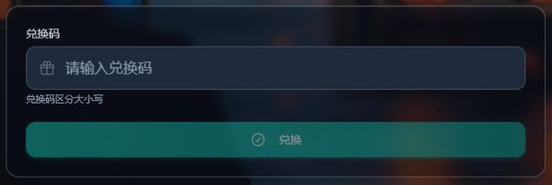

| 兑换结果 | 继续核对 |
| --- | --- |
| 余额变更 | 账户余额与兑换最近活动 |
| 并发变更 | 个人资料中的并发限制；并发不是余额 |
| 订阅权益 | 我的订阅中的分组、有效期和额度 |

兑换码不一定都是充值码，以结果中的权益类型和变更为准。邀请码用于注册，不能当普通兑换码使用。失败时先查来源、大小写、有效期和是否已使用，连续猜码不会增加权益。

### 查看邀请返利

入口：左侧「邀请返利」。先看自己的返利比例和当前活动条件，再区分三项金额：

| 字段 | 含义 |
| --- | --- |
| 可转返利额度 | 当前可以转入账户余额的返利 |
| 冻结中 | 尚未满足解冻条件的部分 |
| 历史返利额度 | 历史累计数值，不等于现在可用余额 |

确有需要时，使用「转入余额」，会转入当时全部可用返利；成功后刷新核对账户余额。冻结中的部分不会因此全部到账。

转入站内余额与提现是两件事。当前用户页没有通用自助提现流程，是否支持提现及其条件需向站方确认，不能把历史累计或活动奖励直接当作可提现金额。

### 活动奖励

入口：「活动中心」。打开具体活动，先读参与资格、领取方式、有效期和到账说明。奖励可能直接进入余额，也可能需要兑换或满足解冻条件；“已参与”“奖励冻结中”和“已到账”不能混为一个结果。

不必为完成本课参与活动、邀请他人或转入返利。能指出当前奖励记录和对应权益去哪里核对，就完成本节。

## 9. 账户保护：密码、验证与余额提醒

入口：左侧「个人资料」。完整 Key、登录密码、邮箱验证码和认证器二维码都要保密，在本站实际表单中输入，不放进提示词或求助截图。

### 密码与双因素认证

需要修改密码时，在「修改密码」填写当前密码、新密码、确认新密码。网页要求新密码至少8个字符，两次一致后提交，以成功提示为准；若之后要求重新登录，使用新密码。

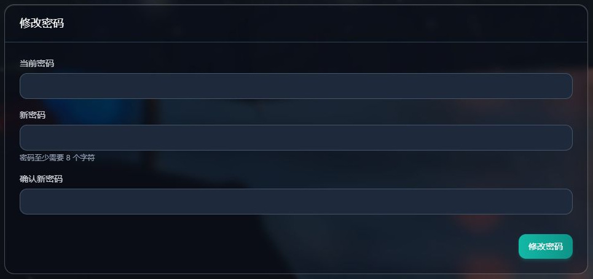

本次界面核对时，双因素认证（2FA）卡片显示「功能未开放」，先认识状态即可。以后页面开放时，可按提示先验证邮箱或当前密码，再用认证器扫码，输入认证器生成的6位码确认。**开始设置、看到二维码还不等于启用成功**，要回到状态卡确认“已启用”。邮箱验证码与认证器验证码是两种用途不同的码，按当前提示填写。

本课练习只查看安全状态。二维码、手动设置密钥和验证码都不作为教学截图内容；功能未开放时，按当前页面状态理解即可。

### 设置余额不足邮件提醒

页面开放「余额不足提醒」后，真正需要提醒时按以下顺序完成：

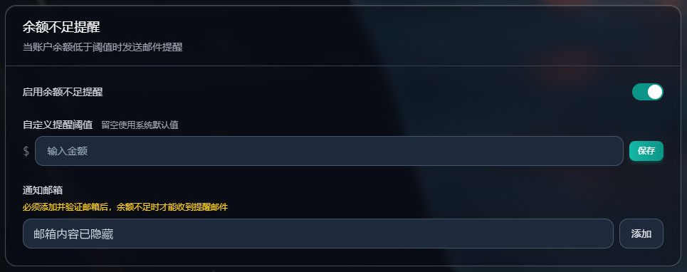

图：只展示设置入口，未修改开关、阈值或邮箱；截图不代表已经完成邮箱验证。

1. 开启「启用余额不足提醒」。
2. 在「自定义提醒阈值」填写金额，点击旁边「保存」。留空或0表示使用系统默认值，不表示余额归零才提醒。
3. 在「通知邮箱」添加自己能收信的邮箱，点击「发送验证码」。
4. 填收到的6位邮箱验证码并「验证」。
5. 确认该邮箱显示「已验证」，且这行邮箱的开关开启。

只打开提醒开关还不够。系统使用已验证且未停用的通知邮箱列表，最多3个；**不会自动把登录主邮箱加入低余额收件人**。

低余额提醒通常在一次扣费使余额从阈值上方跨到下方时触发，不是每天固定播报；余额已经很低时才开启，也不要依赖它立即补发。订阅期限仍要主动去「我的订阅」查看，不把有没有收到邮件当成是否有效的唯一判断。

## 10. 不花钱完成练习，再学会求助

按自己的账户实际情况完成这份清单，无需下单、生成任务、兑换、重置 Key 或修改安全设置：

- 找到模型广场，指出一个模型的分组和计价单位。
- 找到账户余额，说明它与 Key 限额的区别。
- 打开订阅购买页和我的订阅，认清当前套餐或空状态。
- 在已有 Key 的列表中找到分组、期限、状态和限额；没有 Key 时只认识入口。
- 找到使用记录、视频站消费记录和我的订单，说出各查什么。
- 找到发票、兑换、邀请及个人资料入口；菜单未开放时记录当前实际情况。
- 查看余额提醒是否开放，并说出“开启＋阈值＋已验证通知邮箱”三项要求。

能完成这些定位，就学完了本课。

### 常见问题

| 问题 | 先怎么处理 |
| --- | --- |
| 余额还有钱，为什么不能用？ | 核对 Key 分组、状态、有效期和限额；订阅分组还要查该分组订阅，IP或分组权限也可能拦截 |
| 订阅还有每日额度，为什么提示超限？ | 继续看每周、每月及 Key 限额，每一项都要满足 |
| 换把 Key，费用会从零开始吗？ | 新 Key 有自己的计数，账户余额和原有历史消费仍在；同时核对是否换了分组 |
| 支付工具扣钱了，余额没变怎么办？ | 回原订单刷新，核对是否已完成；保留订单及付款信息联系站方，先别再付一单 |
| 客户端失败，可以直接再点一次吗？ | 先查原任务和消费记录；超时可能已提交，不能保证重试免费 |
| 没有记录，是不是没收费？ | 先查账户、入口、时间和筛选；空列表本身不足以判断 |
| 没收到低余额邮件？ | 查提醒开关、阈值及通知邮箱验证/开关状态，也看是否发生了跨阈值扣费 |
| 退款或发票申请提交了，算完成吗？ | 看后续状态；退款另核对支付工具，发票在已开票后下载 |

### 复制一份脱敏求助信息

先保存完整错误与发生时间，再填写能找到的信息。没有的项目写“未显示”，不用为了凑齐资料重复调用或付款。

```text
我遇到的问题：
发生时间（含时区）：
使用入口：聊天工具 / 外部生图 / 本站视频站 / 充值订单 / 其他
客户端名称与版本（如适用）：
Key 名称与所属分组（不填完整 Key）：
模型名称、任务参数（如适用）：
页面显示的金额与币种（照原样填写）：
订单 / 任务 / 请求 ID（未显示则注明）：
当前状态与完整错误原文：
我已检查的账户、时间和筛选：
我做过哪些操作，是否曾重复提交：
脱敏截图：
```

订单号、付款凭证和账户资料只在站方指定的私密渠道提供，公开截图继续遮挡。完整 Key、密码、验证码、认证器二维码、支付二维码和含恢复参数的链接不要发出。

---

编写记录（不放入学员页面）：本稿依据 `research/billing-account/` 下三份源码审计及本轮订阅、订单、发票、兑换与个人资料界面观察整理。只读源码 HEAD 为 `ee7f92504a15dfa2af47e7f6ed3f13fac0f07497`；本地规则不等于所有线上配置。本轮未创建订单/Key、付款、调用收费模型、兑换、提交退款/发票或修改账户安全。配图包含本轮新采集的8张脱敏局部图与既有入口图；空记录图只教定位，订单明细被遮挡不代表空订单列表。通知邮箱截图的私人预填内容已遮盖，不当作真实空输入框或验证完成。充值单位历史说明仍有冲突，本稿不提供固定汇率、充值比例或价格算例。
