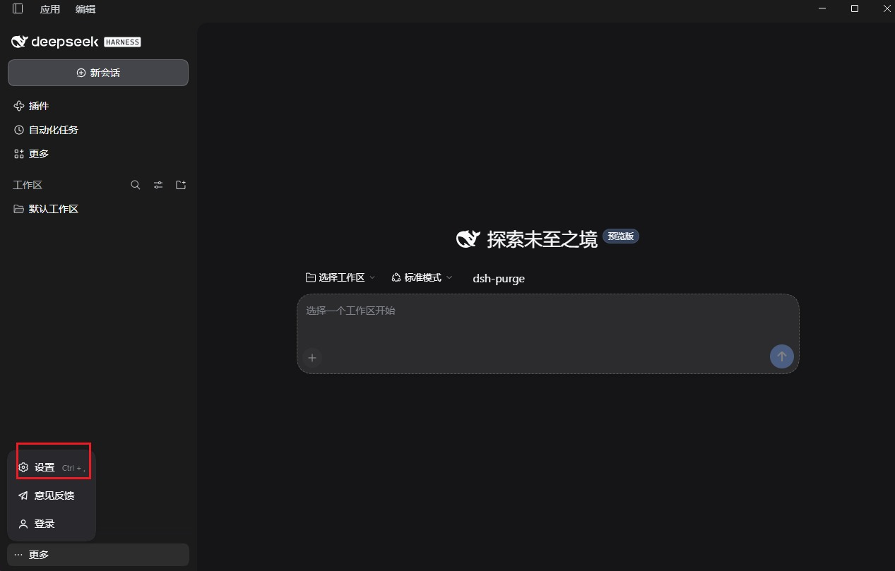
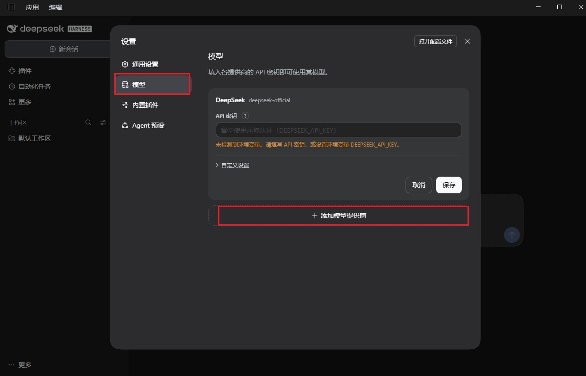
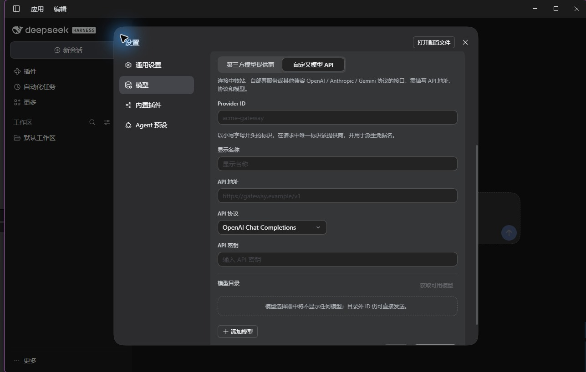
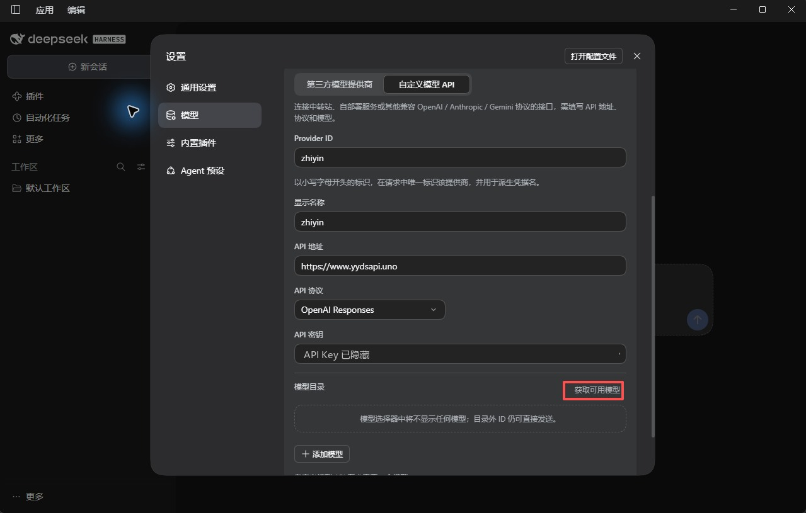
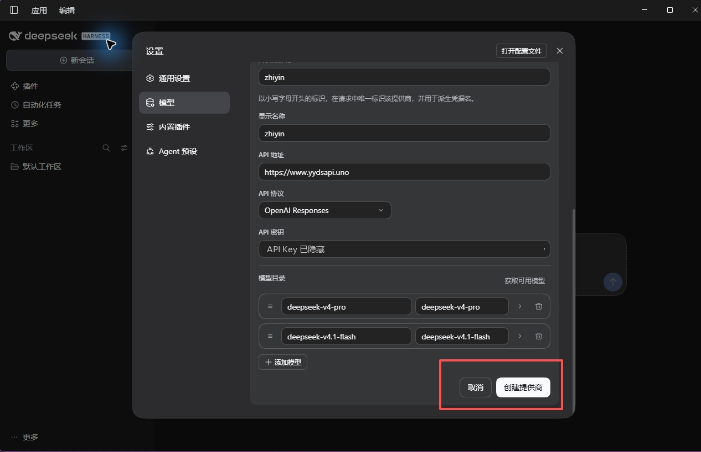

# 在 DeepSeek Harness 中开始对话

所属分类：模型入门。网页入口：`#deepseek`。配置流程更新：2026-11-17，依据用户提供的五张实机截图。

安装 Harness，按图连接本站，再发出第一条消息。本课完成后，你能选中本站 DeepSeek 模型、改写一段通知，并在使用记录中找到对应调用。之后可继续学习 [Harness 工作区、文件任务与会话协作](13-DeepSeek-Harness详细使用.md)。

## 01 准备本站 DeepSeek 密钥

锚点：`deepseek-prepare`

到本站 [API 密钥](https://www.yydsapi.uno/keys)准备一把有效的 **DeepSeek 分组普通 API Key** 与可用额度。在密钥的“使用密钥”或[模型广场](https://www.yydsapi.uno/model-plaza)核对支持的完整模型 ID。

配图中的模型为 `deepseek-v4-pro`、`deepseek-v4.1-flash`，以自己的分组实际权限为准。练习会产生调用费用；视频站专用 Key 不能用于此处。

## 02 安装并打开 Harness

锚点：`deepseek-install`

从 [DeepSeek Harness 官网](https://www.deepseek.com/harness/)下载适合电脑系统的安装包，按安装器提示完成安装并打开应用。已安装的用户直接配置。本课在 Harness 的设置界面操作，无需安装 Claude Code 或修改它的配置文件。

完成检查：Harness 窗口已打开，左下角能找到“更多”。

## 03 跟着五张图，添加本站模型

锚点：`deepseek-connect`

### 1. 左下角「更多 → 设置」

点击左下角**更多**，再点击**设置**。



### 2. 模型 → 添加模型提供商

在设置左侧选择**模型**，点击下方**添加模型提供商**。



### 3. 选择「自定义模型 API」

在表单顶部选择**自定义模型 API**。



### 4. 填写地址、协议与 Key，获取模型

| 字段 | 填写内容 |
| --- | --- |
| Provider ID | `zhiyin`，小写标识；已存在时编辑原提供商 |
| 显示名称 | `zhiyin` |
| API 地址 | `https://www.yydsapi.uno` |
| API 协议 | OpenAI Responses |
| API 密钥 | 自己的完整本站 DeepSeek 分组普通 API Key |

按图填写根地址，**不追加 `/v1` 或 `/responses`**。协议明确选择 OpenAI Responses。填好 Key 后点击**获取可用模型**。



### 5. 确认模型目录，创建提供商

检查获取到的完整模型 ID。图中是 `deepseek-v4-pro` 和 `deepseek-v4.1-flash`，以自己的 Key 返回且有权限调用的模型为准，再点击右下角**创建提供商**。



列表为空或读取失败时，可以点**添加模型**，手动填写在本站确认可用的完整模型 ID，不要只写“DeepSeek”。创建成功后还需发送一次消息，才能验证实际调用。

完成检查：已创建名为 `zhiyin` 的提供商，模型目录中能看到自己的 DeepSeek 模型。网页中的五张图片可以点击放大，Esc 或关闭按钮退出。

## 04 选工作区、选模型，开始提问

锚点：`deepseek-task`

1. 在电脑上新建空文件夹 `deepseek-practice`。
2. 回到 Harness 主界面，点击**选择工作区**，添加并选中这个文件夹，再新建会话。
3. 点击输入框上方的模型名称，选择 **zhiyin** 提供商下的 DeepSeek 模型。第一次先用**标准模式**，不要沿用截图主界面中原本选中的其他模型。
4. 发送下面的练习：

```text
请用中文帮我把下面的通知改写得清楚、友好，控制在 100 字以内，并给出一个标题。
原文：这周六下午两点在社区活动室有一次 AI 入门分享，不需要编程基础，请带电脑，结束后有提问时间。
只在对话中回答，暂时不要读取文件、修改文件或运行命令。
```

收到回复后，在同一会话继续追问：

```text
把刚才的通知再改成适合发到家长群的语气，保留时间、地点和需要带电脑这三个信息。
```

完成检查：回复符合要求，第二次改写仍保留时间、地点和需要带电脑的信息。

## 05 检查回复与消费

锚点：`deepseek-verify`

先检查内容，再打开本站[使用记录](https://www.yydsapi.uno/usage)，按时间、密钥和模型核对本次调用。模型在回复里自报名称不能代替实际记录。一项任务可能产生多次请求，具体以本站记录为准。

下一步可进入 `#tool/deepseek-harness?section=agent-workspace`，学习工作区、文件任务、计划、分叉和子代理协作。

## 06 遇到问题

锚点：`deepseek-help`

| 现象 | 先检查 |
| --- | --- |
| 获取模型失败或列表为空 | 根地址、OpenAI Responses、完整 Key 与分组权限；必要时手动添加已确认可用的完整 ID。 |
| 输入框不能发送 | 先选择工作区，再选中 zhiyin 下的目标模型。 |
| 仍使用旧模型 | 创建提供商后，当前会话仍需重新选择模型。 |
| 401、403 或模型无权限 | Key 是否有效，额度是否可用，模型是否属于对应分组。 |
| 404 或协议不匹配 | 地址填本站根域名，协议选 OpenAI Responses，不额外追加路径。 |
| 以前按旧教程配置过 Claude Code | Harness 与 Claude Code 配置独立，旧设置不会自动迁入 Harness；按本课重新添加提供商。 |

仍有问题时，记录时间与脱敏错误，查看网站“常见问题”。不要将完整 Key 放入截图或反馈文字。

## 图片与核验说明

五张实机操作图由用户提供，第四、第五张中的密钥区域已遮挡。图片展示到创建提供商阶段，本轮没有代用户执行模型付费调用。原始图与处理后文件的映射见 [图片资源说明](../preview/assets/deepseek-harness/README.md)。
