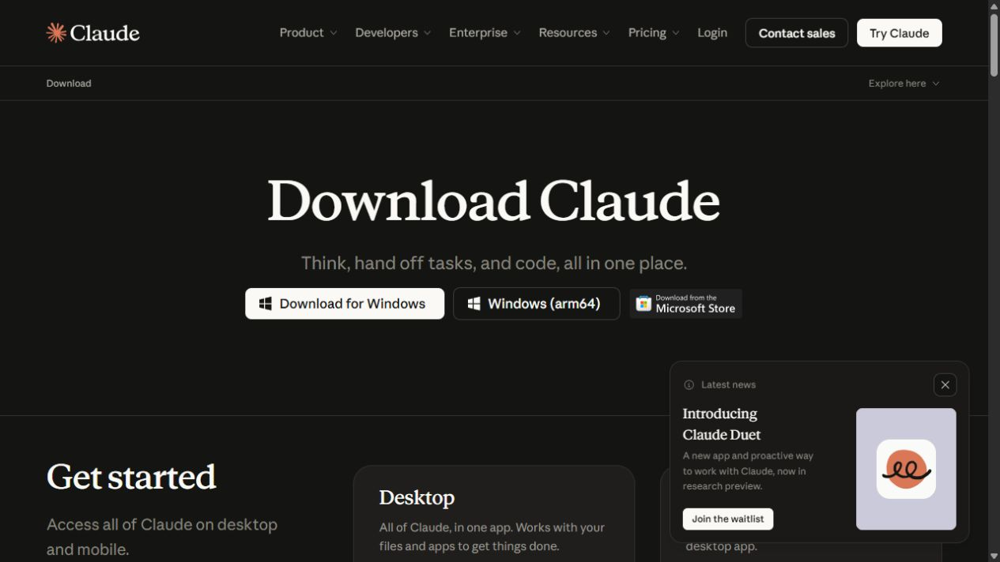
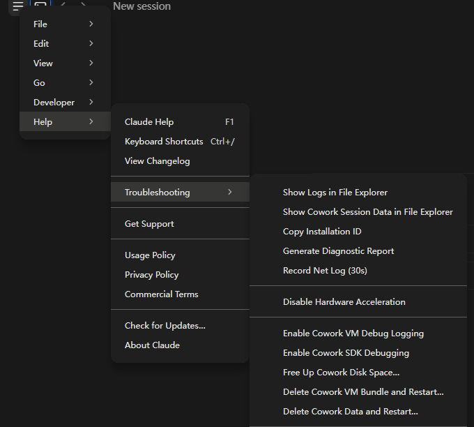
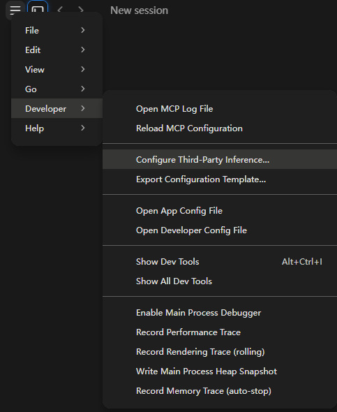
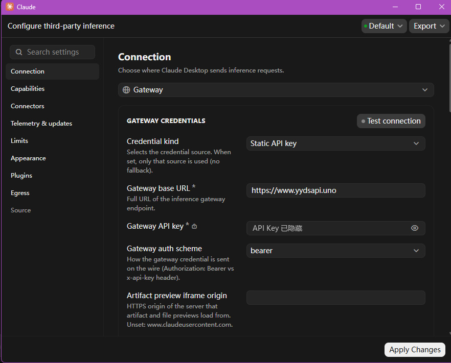
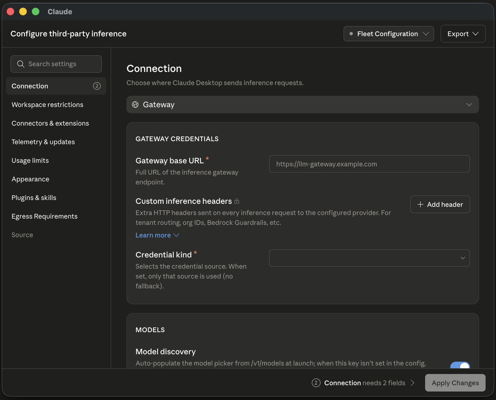

# 在 Claude 桌面端开始对话

所属栏目：模型入门 → Claude。网页入口：`#claude`。配图更新日期：2026-11-17；配置流程结合用户实机截图与已核对的桌面端资料整理。

安装 Claude Desktop，通过菜单填好本站地址与 Key，再完成一次通知改写。不需要打开终端或编辑配置文件。熟悉首次对话后，可继续学习 [Claude 桌面端的 Cowork、Code 与协作技巧](12-Claude桌面端配置与Cowork-Code实操.md)。

## 01 准备本站 Claude 密钥

锚点：`claude-prepare`

到本站 [API 密钥](https://www.yydsapi.uno/keys) 页，准备一把 **Claude / Anthropic 文字分组的普通 API Key** 与可用额度。在密钥的“使用密钥”或 [模型广场](https://www.yydsapi.uno/model-plaza) 核对可用的 Claude 模型。

已有合适的 Key 可以继续使用。密钥只填写到自己的 Claude 应用配置窗口；视频站专用 Key 不能用于此处。本站 API 消费与 Claude 官方会员分别计费。

## 02 安装并打开 Claude 桌面端

锚点：`claude-install`

1. 打开 [Claude 官方下载页](https://claude.com/download)，选择适合电脑系统的安装包。
2. 普通 Intel / AMD Windows 电脑选择 Windows，ARM 设备选择 ARM64；其他系统按官网当前选项选择。
3. 完成安装后打开 Claude 应用。本课菜单路径以 Windows 为例，macOS 从屏幕顶部菜单栏进入。



配图为官方网页入口，帮助辨认下载位置；安装选项以当前官网为准。

完成检查：Claude 窗口已打开，能找到应用菜单。已经安装的用户直接继续配置。

## 03 通过菜单连接本站

锚点：`claude-connect`

按下面三张实机图完成菜单与字段配置。网页保留菜单流程示意，以下步骤均在 Claude 应用内完成。

### 1. 启用开发者模式

点击左上角 **☰ 三个横杠 → 帮助 → 故障排查 → 启用开发者模式**。

英文菜单为 **Help → Troubleshooting → Enable Developer Mode**。



用户提供的实机图，展示 Help → Troubleshooting 的位置；本图没有拍到 Enable Developer Mode 选项。若菜单中已经有 **Developer**，可直接进行下一步。


### 2. 打开「配置第三方推理」

再次打开左上角 **☰ → 开发者 → 配置第三方推理**。

英文菜单为 **Developer → Configure Third-Party Inference…**。



用户提供的实机图，按标出的 **Configure Third-Party Inference…** 打开第三方推理配置。


### 3. 选择 Gateway，填写本站地址与 Key

在 **Connection** 中选择网关接入。先选 **Static API key** 凭据类型，再填写出现的密钥字段。

| 界面字段 | 填写内容 |
| --- | --- |
| Inference provider · 推理提供方 | `Gateway` |
| Gateway base URL · 网关地址 | `https://www.yydsapi.uno` |
| Credential kind · 凭据类型 | `Static API key` |
| Gateway auth scheme · 认证方式 | `Bearer` |
| Gateway API key · 网关密钥 | 自己的完整本站普通 Claude 分组 API Key |

```text
https://www.yydsapi.uno
```

填写根地址，不在后面追加 `/v1/messages`。Key 完整复制，不带首尾空格。



用户提供的实机图，展示本站配置字段与 **Apply Changes** 按钮；API Key 区域已遮挡。保存后仍需发送一次消息验证连接。网页中的三张操作图均支持点击放大。

<details>
<summary>参考：官方配置窗口示例</summary>



官方文档配图，用于对照界面。图中为官方示例域名，凭据尚未选完，请按本文表格填写本站信息。来源：[Claude 官方应用内配置说明](https://claude.com/docs/third-party/claude-desktop/in-app-configuration)，2026-11-04 读取。

</details>

### 4. 保存并重启

点击 **Apply Changes**，出现确认窗口时点击 **Save & Restart**。重启后按登录页提示，选择使用已保存的第三方配置进入。完整的第三方配置路线支持跳过 Anthropic 账户登录。

如果重启后 Developer 菜单消失，重新执行“帮助 → 故障排查 → 启用开发者模式”。受管理设备的入口可能由管理员控制。

完成检查：应用已使用保存的第三方配置打开。保存成功后，继续发送一条消息验证连接。

## 04 选择模型，提问并追问

锚点：`claude-task`

1. 进入 Chat 或统一首页，新建对话。
2. 在模型选择器中选本站分组允许调用的 Claude 模型。模型名称与权限以自己的密钥分组为准。
3. 将下面的文字粘贴到输入框，发送后等待回复：

```text
请用中文帮我把下面的通知改写得清楚、友好，控制在 100 字以内，并给出一个标题。
原文：这周六下午两点在社区活动室有一次 AI 入门分享，不需要编程基础，请带电脑，结束后有提问时间。
只在对话中回答，暂时不要读取文件、修改文件或运行命令。
```

检查回复是否保留了时间、地点、需要带电脑和提问时间，再在同一对话追问：

```text
把刚才的通知再改成适合发到家长群的语气，保留时间、地点和需要带电脑这三个信息。
```

部分版本把 Chat 与 Cowork 合并在首页。首次练习直接粘贴文字即可，不必为了寻找旧按钮反复修改 Key。改写同一材料继续原对话；换一个无关任务时新建对话。

## 05 检查回复与本站使用记录

锚点：`claude-verify`

先检查内容是否准确，再到本站 [使用记录](https://www.yydsapi.uno/usage)，按时间、密钥和模型核对调用。模型在回复中自报的名称不能代替使用记录；发送练习会产生模型调用费用。

暂时没看到记录，先检查日期、筛选和实际服务地址，不要反复发消息寻找记录。

完成标准：能收到正常回复、继续追问，通知事实没有丢失，并能找到对应的本站记录。

下一步可进入 `#tool/claude-desktop`，学习 Cowork 整理资料、Code 处理项目及多会话技巧。

## 06 卡住时先检查这里

锚点：`claude-help`

- **找不到开发者菜单：** 先在帮助 → 故障排查中启用开发者模式，必要时更新桌面端；受管理设备按管理员配置处理。
- **配置窗口缺少 Key 输入框：** 核对推理提供方是否为 Gateway，凭据类型是否选 Static API key。
- **保存后仍要求官方账户登录：** 确认完整保存并重启，按登录页提示选择已保存的第三方配置。
- **401、模型权限或额度错误：** 核对 Key 完整有效、所属 Claude 分组、模型权限与可用额度。
- **Gateway was unreachable 或一直等待：** 检查根地址、网络与本站状态，记录脱敏错误后查看常见问题。

桌面端通过自己的配置窗口连接本站。浏览器授权写入 `.claude/settings.json` 的功能属于 Claude Code CLI，不能代替本课配置。

## 资料与核验说明

- [Claude 官方下载](https://claude.com/download)
- [第三方模式概览](https://claude.com/docs/third-party/claude-desktop/overview)
- [Gateway 字段说明](https://claude.com/docs/third-party/claude-desktop/gateway)
- [应用内配置说明](https://claude.com/docs/third-party/claude-desktop/in-app-configuration)

2026-11-17 加入用户提供的三张实机图：Help → Troubleshooting、Developer → Configure Third-Party Inference、Gateway 配置字段。第一张只展示故障排查入口，没有拍到启用开发者模式选项；第三张密钥区域已遮挡。流程图为教学示意，折叠区保留 2026-11-04 读取的官方示例图与资料。图片不代表连接测试成功，本轮未代用户安装客户端、保存真实 Key 或执行付费调用。应用版本与分组支持以实际操作为准。
