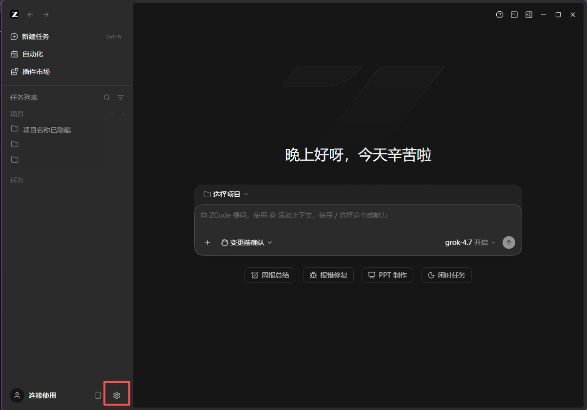
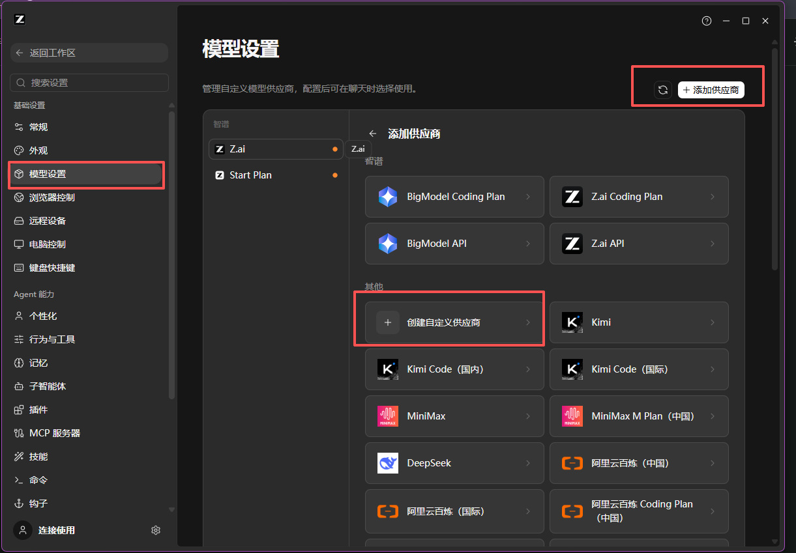
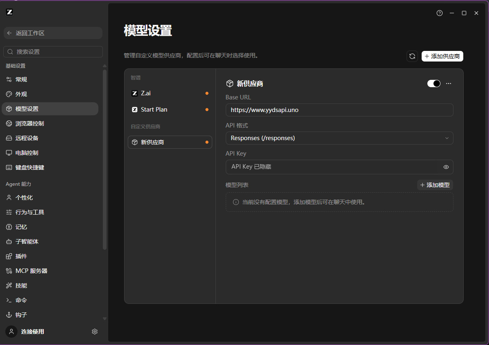
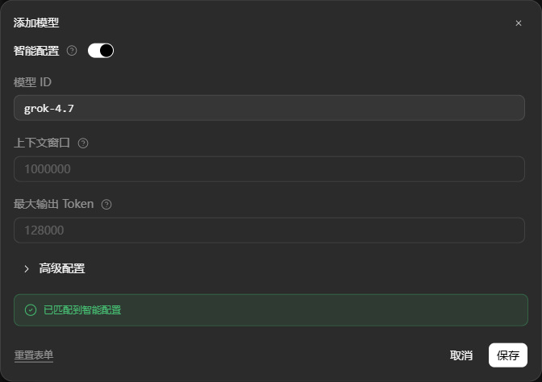
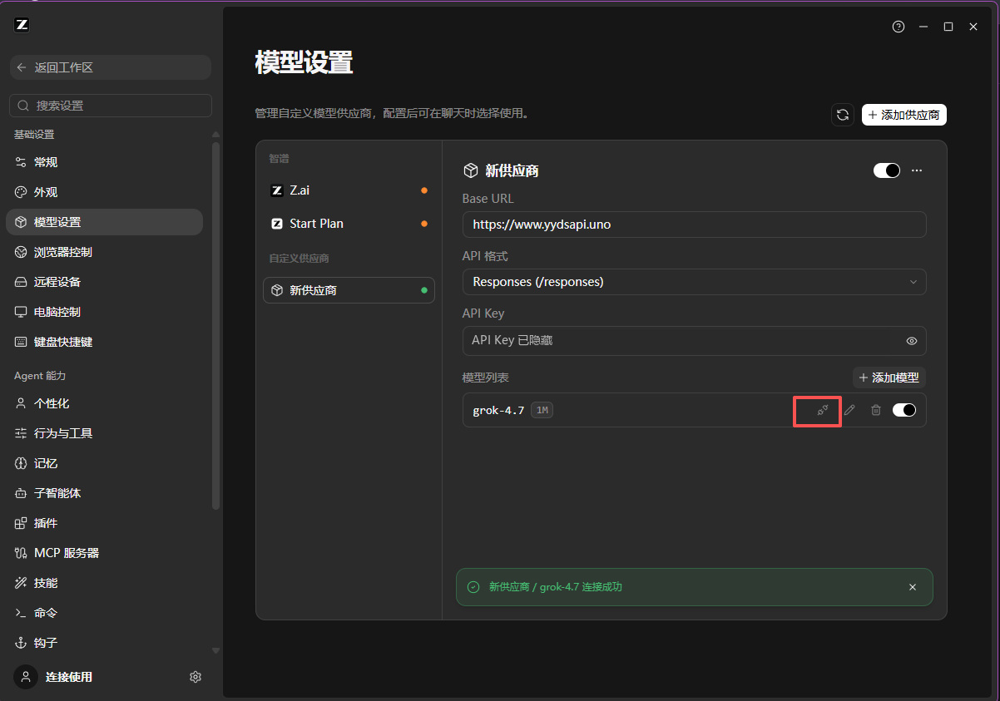

# 在 ZCode 中使用 Grok

所属栏目：模型入门 → Grok。网页入口：`#grok`。配置流程更新：2026-11-17，依据用户提供的五张实机截图；工作区与任务操作沿用已有 ZCode 教程资料。

安装 ZCode，按图添加本站 Grok 模型，再完成一次通知改写。先学会连接、提问与检查，后续可继续学习 [ZCode 的工作区、文件任务与协作](14-ZCode详细使用.md)。

## 01 准备本站 Grok 密钥

锚点：`grok-prepare`

到本站 [API 密钥](https://www.yydsapi.uno/keys) 页，准备一把**具有 Grok 模型权限的普通 API Key**及可用额度。通过密钥的“使用密钥”说明或 [模型广场](https://www.yydsapi.uno/model-plaza) 核对完整模型 ID 和分组权限。本课示例为 `grok-4.7`。

已有合适的 Key 可继续使用。不要直接照抄图片中的凭据，也不要使用视频站专用 Key。ZCode 是使用工具，Grok 是所选模型，本站 Key 决定使用的服务与额度。

## 02 安装并打开 ZCode

锚点：`grok-install`

1. 打开 [ZCode 官网](https://zcode.z.ai/cn) 或 [官方安装页](https://zcode.z.ai/cn/docs/install)，下载适合电脑系统的版本。
2. 普通 Intel / AMD Windows 电脑选择 x64，ARM 设备选择 ARM64；其他系统按官网当前选项选择。
3. 完成安装并打开 ZCode。首次可以跳过数据迁移，找到左下角齿轮设置入口。

完成检查：ZCode 已打开，可以进入模型设置。已安装的用户直接进行下一节。

## 03 按五张图连接本站 Grok 模型

锚点：`grok-connect`

### 1. 左下角齿轮 → 模型设置

打开 ZCode，点击左下角**齿轮设置**，进入**模型设置**。



### 2. 添加供应商 → 创建自定义供应商

在模型设置中点击**添加供应商**，进入**创建自定义供应商**，为本站连接设置一个方便识别的名称。



### 3. 填写本站地址、Responses 格式和 Key

| 字段 | 填写或检查内容 |
| --- | --- |
| Base URL | `https://www.yydsapi.uno` |
| API 格式 | `Responses (/responses)` |
| API Key | 自己的本站普通 API Key，需有 Grok 模型调用权限 |

```text
https://www.yydsapi.uno
```

本课按图填写根地址，选择 **Responses (/responses)**；不要再手动把 `/responses` 拼到 Base URL 后面。Key 在自己的 ZCode 中完整填写，不带首尾空格。



### 4. 添加 Grok 模型，保留智能配置

点击**添加模型**，开启**智能配置**，输入完整模型 ID：

```text
grok-4.7
```

等待匹配模型信息后检查名称并保存。本课使用 `grok-4.7`，实际以自己 Key 可用的模型为准。上下文长度、最大输出等参数通常先保持智能配置的默认值；图中的值是客户端配置，不能当作本站网关或当前模型的实际限制承诺。



### 5. 在模型行测试连接

返回模型列表，点击 `grok-4.7` 所在行的**连接测试图标**，等待结果。图中显示“连接成功”，是用户提供的当次操作结果。



测试连接和后续提问都可能产生模型调用费用。图中的成功提示不代替你自己的测试；回到工作区发送一次消息后，再核对本站使用记录。网页中的五张实机图支持点击放大。

## 04 选择工作区与模型，提问并追问

锚点：`grok-task`

1. 在电脑上新建空的 `grok-practice` 文件夹，在 ZCode 中选择它作为练习工作区。
2. 新建任务，点击输入框旁的模型选择器，选择刚才添加的本站供应商下的 **grok-4.7**。
3. 执行模式先选**变更前确认**。本次只做文字改写，复制下方练习到任务输入框并发送。

```text
请用中文帮我把下面的通知改写得清楚、友好，控制在 100 字以内，并给出一个标题。
原文：这周六下午两点在社区活动室有一次 AI 入门分享，不需要编程基础，请带电脑，结束后有提问时间。
只在对话中回答，暂时不要读取文件、修改文件或运行命令。
```

收到回复后，检查时间、地点、带电脑和提问时间是否保留，再在同一任务中继续追问：

```text
把刚才的通知再改成适合发到家长群的语气，保留时间、地点和需要带电脑这三个信息。
```

改同一份材料时继续当前任务；换一个不相关的问题时新建任务。创建供应商和添加模型后，还要检查当前任务实际选中了哪个模型。

## 05 检查结果与本站使用记录

锚点：`grok-verify`

先检查回复是否符合要求，再到本站 [使用记录](https://www.yydsapi.uno/usage)，按时间、Key 和模型核对这次调用。测试连接和正式提问都可能产生请求，模型在回复中自报名称不能代替记录。

完成标准：能收到改写结果并继续追问，事实保持准确，本站能找到对应调用。

下一步进入 `#tool/zcode?section=agent-workspace`，学习工作区、文件引用与第一次文件任务，再按需阅读辅助对话、分叉、审阅和子智能体章节。

## 06 遇到问题，先检查这里

锚点：`grok-help`

- **找不到模型：** 确认已保存模型、供应商已启用；回任务模型选择器选择本站供应商下的 `grok-4.7`。
- **连接测试失败或 401：** 检查完整 Key、首尾空格和密钥是否有效。
- **403、模型无权限或额度不足：** 核对 Key 所在分组的 Grok 权限和可用额度。模型广场中有某模型不代表每把 Key 都能调用。
- **400 / 404 或协议报错：** 核对 Base URL 为 `https://www.yydsapi.uno`，API 格式为 `Responses (/responses)`，模型 ID 拼写正确。不要将本课套用为 Claude 的 Anthropic 配置。
- **智能配置参数不符合实际模型限制：** 以本站支持范围和错误信息为准，核对参数；不要把截图上下文和最大输出数值当作保证。
- **测试成功但任务没有正常回复：** 检查当前任务的模型、工作区、执行模式和具体错误，再到本站使用记录核对。

需要求助时保留时间、模型与脱敏错误，查看「常见问题」，不要公开完整 Key。

## 图片与资料说明

五张图由用户于 2026-11-17 提供。第一张项目名称已隐藏，第三、第五张 API Key 区域以不透明遮挡覆盖，第四张裁剪保留添加模型弹窗。第五张显示用户当时的连接成功提示，不代表本轮代理进行了连接测试或付费调用。

工作区、执行模式与任务管理沿用 2026-11-04 已整理的 [ZCode 官方配置文档](https://zcode.z.ai/cn/docs/configuration)、[Agent 使用文档](https://zcode.z.ai/cn/docs/agents) 与 [任务管理文档](https://zcode.z.ai/cn/docs/task-management)。本轮未代用户安装客户端、写入真实 Key 或执行收费模型请求；可用模型与功能以实际版本和分组权限为准。
